# Meetup (`https://www.meetup.com`) — Comprehensive Feature, Architecture, Design System & UI/UX Functions Report

> **Target Platform:** `https://www.meetup.com` (Web Next / Bending Spoons Platform Era)  
> **Automation Stack:** Python + Playwright (`channel="chrome"`, headless Chromium/Chrome, `1440×900` desktop viewport) authenticated via `/home/azadmin/MeetUp/.cred`  
> **Authenticated Test Principal:** `Member:484670701` (`wlfjck` / `wlfjck@gmail.com`, Default Location: San Francisco, CA `37.7749, -122.4194`)  
> **Next.js Build ID:** `5b8dcf3e0a1ec3271e97f4a1908d04b4a7573712`  
> **Captured Local Visual Artifacts:** **141 Screenshots** stored in [`./screenshots/`](./screenshots/)

---

## Table of Contents

1. [Executive Summary & Exploration Methodology](#1-executive-summary--exploration-methodology)
2. [System, Frontend & Backend Architecture Deep Dive](#2-system-frontend--backend-architecture-deep-dive)
   - [2.1 Next.js Pages Router & SSR Hydration Architecture](#21-nextjs-pages-router--ssr-hydration-architecture)
   - [2.2 Complete Next.js Route Map (`window.__BUILD_MANIFEST`)](#22-complete-nextjs-route-map-window__build_manifest)
   - [2.3 GraphQL API Layer (`/gql2`), Apollo Normalized Cache & Persisted Queries](#23-graphql-api-layer-gql2-apollo-normalized-cache--persisted-queries)
   - [2.4 Authentication, Cookie Security & Session Lifecycle (`.cred` Analysis)](#24-authentication-cookie-security--session-lifecycle-cred-analysis)
   - [2.5 Observability, Experimentation & Third-Party Integrations](#25-observability-experimentation--third-party-integrations)
3. [UI/UX Design System ("Design System 2" / `ds2-*`) Specification](#3-uiux-design-system-design-system-2--ds2--specification)
   - [3.1 Aesthetic Philosophy & Visual Language](#31-aesthetic-philosophy--visual-language)
   - [3.2 Typography System (`NeuSans` & `ds2-*` Type Scale)](#32-typography-system-neusans--ds2--type-scale)
   - [3.3 Semantic Color, Surface, Stroke & Elevation Tokens](#33-semantic-color-surface-stroke--elevation-tokens)
   - [3.4 Spacing, Geometry & Responsive Dual-DOM Architecture](#34-spacing-geometry--responsive-dual-dom-architecture)
   - [3.5 Interactive Component Primitives (Radix UI + Lucide)](#35-interactive-component-primitives-radix-ui--lucide)
4. [Feature-by-Feature Functional, Architectural & UI Combination Analysis](#4-feature-by-feature-functional-architectural--ui-combination-analysis)
   - [4.1 Feature 1: Forced Onboarding & Personalization Wizard (`/welcome/[...step]`)](#41-feature-1-forced-onboarding--personalization-wizard-welcomestep)
   - [4.2 Feature 2: Global Header, Dual Typeahead Search, Stateful CTAs & Footer](#42-feature-2-global-header-dual-typeahead-search-stateful-ctas--footer)
   - [4.3 Feature 3: Personalized Home Dashboard (`/home/`) & Event Card Actions](#43-feature-3-personalized-home-dashboard-home--event-card-actions)
   - [4.4 Feature 4: Event & Group Discovery Engine (`/find/`, `/topics/`, `/cities/`)](#44-feature-4-event--group-discovery-engine-find-topics-cities)
   - [4.5 Feature 5: Event Detail Page, RSVP Workflows, Flyer Studio & Attendees Directory](#45-feature-5-event-detail-page-rsvp-workflows-flyer-studio--attendees-directory)
   - [4.6 Feature 6: Personal Event Schedule & Calendar Export (`/your-events/`)](#46-feature-6-personal-event-schedule--calendar-export-your-events)
   - [4.7 Feature 7: Community Groups Hub & Group Detail Ecosystem (`/[groupUrlname]/*`)](#47-feature-7-community-groups-hub--group-detail-ecosystem-groupurlname)
   - [4.8 Feature 8: 6-Step Group Creation Wizard, AI Description Generator & Organizer Checkout (`/start/`)](#48-feature-8-6-step-group-creation-wizard-ai-description-generator--organizer-checkout-start)
   - [4.9 Feature 9: Member Profiles, Social Graph, Messaging & Notifications](#49-feature-9-member-profiles-social-graph-messaging--notifications)
   - [4.10 Feature 10: Account Settings, Privacy, Granular Email Controls & Payments Ledger (`/account/*`, `/payments/*`)](#410-feature-10-account-settings-privacy-granular-email-controls--payments-ledger-account-payments)
   - [4.11 Feature 11: Monetization Tiers (Meetup+, Meetup Pro) & Developer GraphQL Portal](#411-feature-11-monetization-tiers-meetup-meetup-pro--developer-graphql-portal)
5. [Complete Catalog of Captured Screenshots (`01`–`95`)](#5-complete-catalog-of-captured-screenshots-0195)

---

## 1. Executive Summary & Exploration Methodology

Meetup (`https://www.meetup.com`) operates a hybrid Server-Side Rendered (SSR) and Single-Page Application (SPA) web platform built on **Next.js (Pages Router)**, **React 18**, **Apollo GraphQL Client (`/gql2`)**, **Radix UI**, and a custom **Tailwind CSS Design System 2 (`ds2-*`)** introduced following Meetup's acquisition by **Bending Spoons**.

### Exploration & Testing Methodology
1. **Session & Cookie Injection**: Loaded all 24 cookies from `/home/azadmin/MeetUp/.cred` into Playwright's `BrowserContext`. Special handling was implemented for `__Host-NEXT_MEETUP_CSRF` (which uses the strict RFC 6265bis `__Host-` prefix requiring `url="https://www.meetup.com"`, `secure=True`, and no `domain` attribute) and `sameSite="no_restriction"` (`SameSite=None; Secure`).
2. **Route & Bundle Reverse-Engineering**: Extracted the complete 150+ route manifest from `window.__BUILD_MANIFEST` and inspected Next.js webpack chunks (`_app-1dd8a5832676cd3d.js`, `[...step]-0f2b35a7fd27fe2a.js`) to uncover every hidden route, onboarding state machine branch, and GraphQL persisted query hash.
3. **Network & GraphQL Interception**: Attached Playwright request/response listeners to `https://www.meetup.com/gql2` and `window.__NEXT_DATA__` / `window.__APOLLO_STATE__` to log every GraphQL query, mutation, input variable schema, and normalized cache entity.
4. **Exhaustive UI State & Combination Testing**: Systematically navigated every functional route and triggered all interactive UI combinations—including radio cards, multi-select pill chips, custom inputs, date validation errors, search combobox typeaheads, filter popovers, calendar pickers, share/flyer generators, report modals, RSVP guest & email-consent flows, group management menus, photo upload modals, AI description generation, and GraphiQL execution—capturing **141 local PNG screenshots** in `./screenshots/`.

---

## 2. System, Frontend & Backend Architecture Deep Dive

```
┌───────────────────────────────────────────────────────────────────────────────────┐
│                           CLIENT BROWSER (React 18 + Next.js)                     │
│  ┌─────────────────────────┐  ┌─────────────────────────┐  ┌───────────────────┐  │
│  │ Design System 2 (ds2-*) │  │ Radix UI Primitives     │  │ Grafana Faro SDK  │  │
│  │ NeuSans + Tailwind CSS  │  │ Dialog/Menu/Popper/Tabs │  │ + Sentry Tracing  │  │
│  └───────────┬─────────────┘  └───────────┬─────────────┘  └─────────┬─────────┘  │
│              └────────────────────────────┼──────────────────────────┘            │
│                                           ▼                                       │
│  ┌─────────────────────────────────────────────────────────────────────────────┐  │
│  │            Apollo Client Normalized Cache (window.__APOLLO_STATE__)         │  │
│  │     Automatic Persisted Queries (APQ v1 sha256Hash) + Batch HTTP Link       │  │
│  └────────────────────────────────────────┬────────────────────────────────────┘  │
└───────────────────────────────────────────┼───────────────────────────────────────┘
                                            │ HTTPS (Cookies + CSRF Header)
                    ┌───────────────────────┼───────────────────────┐
                    ▼                       ▼                       ▼
     ┌──────────────────────────┐ ┌──────────────────┐ ┌─────────────────────────┐
     │ Next.js SSR Edge/Node    │ │ GraphQL Gateway  │ │ Orion v3 Telemetry &    │
     │ getServerSideProps       │ │ POST /gql2       │ │ Identity Service        │
     │ (__NEXT_DATA__ Hydration)│ │ Batch & APQ      │ │ /orion/v3/identity/*    │
     └──────────────────────────┘ └─────────┬────────┘ └─────────────────────────┘
                                            │
              ┌─────────────────────────────┼─────────────────────────────┐
              ▼                             ▼                             ▼
   ┌────────────────────┐       ┌──────────────────────┐      ┌─────────────────────┐
   │ Core Domain Svc    │       │ Geo & Search Engine  │      │ Billing & Payments  │
   │ Members / Groups / │       │ GeoHash / Density /  │      │ Stripe 3DS / PayPal │
   │ Events / RSVPs     │       │ Recommended Ranker   │      │ ProfitWell / Pledge │
   └────────────────────┘       └──────────────────────┘      └─────────────────────┘
```

### 2.1 Next.js Pages Router & SSR Hydration Architecture
- **Framework**: Next.js Pages Router (`__N_SSP: true` indicating `getServerSideProps` execution on initial navigation, followed by client-side routing via `next/router`).
- **Build Assets**: Hosted on `https://www.meetup.com/_next/static/` (and `https://secure.meetupstatic.com/next/images/` for static imagery).
- **SSR Hydration Payload (`#__NEXT_DATA__`)**:
  - `props.pageProps.__APOLLO_STATE__`: Pre-populated Apollo Client normalized cache from server-side GraphQL queries, eliminating loading spinners on initial page paint.
  - `props.pageProps.RequestMeta`: Contains request headers, geolocation coordinates, experiment flags, and client metadata.
  - `props.pageProps.__N_REDIRECT`: Used by server-side middleware/guards (e.g., redirecting un-onboarded accounts with `isNew: true` to `/welcome/intent/`).
  - `locale` / `locales`: Multi-locale internationalization support (`en-US`, `de-DE`, `es`, `Es-ES`, `fr-FR`, `it-IT`, `ja-JP`, `ko-KR`, `nl-NL`, `pl-PL`, `pt-BR`, `ru-RU`, `th-TH`, `tr-TR`).

### 2.2 Complete Next.js Route Map (`window.__BUILD_MANIFEST`)
Inspecting `window.__BUILD_MANIFEST.sortedPages` revealed **150+ distinct routes** organized into 12 architectural domains:

| Domain | Next.js Page Routes |
| :--- | :--- |
| **Core Member Surfaces** | `/`, `/home`, `/your-events`, `/groups`, `/find`, `/find/online-events`, `/find/[...all]`, `/cities`, `/topics`, `/topics/[topicUrlkey]`, `/topics/[topicUrlkey]/all-topics`, `/notifications`, `/messages`, `/friends`, `/bookmarks` |
| **Onboarding Flow** | `/welcome/[...step]` (14-step dynamic catch-all state machine) |
| **Group Ecosystem** | `/[groupUrlname]`, `/[groupUrlname]/events`, `/[groupUrlname]/events/past`, `/[groupUrlname]/events/calendar`, `/[groupUrlname]/events/calendar/[...date]`, `/[groupUrlname]/members`, `/[groupUrlname]/photos`, `/[groupUrlname]/photos/[albumId]`, `/[groupUrlname]/photos/[albumId]/[photoId]`, `/[groupUrlname]/discussions`, `/[groupUrlname]/discussions/[discussionId]`, `/[groupUrlname]/polls`, `/[groupUrlname]/polls/[pollId]`, `/[groupUrlname]/feedback-overview` |
| **Event Ecosystem** | `/[groupUrlname]/events/[eventId]`, `/[groupUrlname]/events/[eventId]/attendees`, `/[groupUrlname]/events/[eventId]/waiting-list`, `/[groupUrlname]/events/[eventId]/rsvp-Survey`, `/[groupUrlname]/events/[eventId]/confirmation`, `/[groupUrlname]/events/[eventId]/EventChatWrapper` |
| **Group Organizer Tools** | `/[groupUrlname]/manage-group/settings`, `/[groupUrlname]/manage-group/settings/basic`, `/[groupUrlname]/manage-group/settings/topics`, `/[groupUrlname]/manage-group/settings/members`, `/[groupUrlname]/manage-group/settings/optional`, `/[groupUrlname]/manage-group/settings/group-status`, `/[groupUrlname]/manage-group/settings/appearances`, `/[groupUrlname]/manage-group/settings/dues`, `/[groupUrlname]/manage-group/settings/roles`, `/[groupUrlname]/manage-group/settings/analytics`, `/[groupUrlname]/manage-group/communicate`, `/[groupUrlname]/schedule`, `/[groupUrlname]/events/[eventId]/edit`, `/[groupUrlname]/events/[eventId]/copy`, `/[groupUrlname]/events/[eventId]/manage-attendance` |
| **Group Creation (`/start`)** | `/start`, `/start/location`, `/start/topics`, `/start/name`, `/start/description`, `/start/guidelines`, `/start/plans`, `/how-to-group-start` |
| **Member Profiles** | `/members/[memberId]`, `/members/[memberId]/group/[groupId]` |
| **Account & Settings** | `/account`, `/account/personal`, `/account/management`, `/account/comm`, `/account/comm/[groupUrlname]`, `/account/comm/pro/[proUrlname]`, `/account/privacy`, `/account/services`, `/account/interests`, `/account/mobile`, `/account/subscription`, `/account/member-plus`, `/account/payment-methods`, `/account/oauth_apps`, `/account/contact-upload` |
| **Payments & Subscriptions** | `/payments`, `/payments/payments_made`, `/payments/dues_payments_made`, `/payments/transactions`, `/subscription/checkout/member-plus`, `/subscription/checkout/core/organizer`, `/subscription/checkout/pro`, `/stripe-3ds-verification`, `/paypal-onboarding` |
| **Meetup Pro (Enterprise)** | `/meetup-pro`, `/pro/[networkUrlname]`, `/pro/[networkUrlname]/admin`, `/pro/[networkUrlname]/admin/events`, `/pro/[networkUrlname]/admin/groups`, `/pro/[networkUrlname]/admin/members`, `/pro/[networkUrlname]/admin/analytics`, `/pro/[networkUrlname]/admin/contact-lists`, `/pro/[networkUrlname]/admin/integrations`, `/pro/[networkUrlname]/admin/rsvp-questions`, `/pro/[networkUrlname]/admin/settings`, `/pro/[networkUrlname]/admin/speakers`, `/pro/[networkUrlname]/admin/sponsors` |
| **Marketing & SEO Landings** | `/lp/[slug]`, `/lp/upgrade-meetup-plus`, `/lp/meetup-pro-features`, `/lp/friendship-and-socializing`, `/about`, `/apps`, `/sitemap`, `/sitemaps/[...all]` |
| **Developer & GraphQL API** | `/graphql`, `/graphql/guide`, `/graphql/auth`, `/graphql/playground`, `/graphql/oauth/list`, `/graphql/oauth/create`, `/graphql/oauth/view/[key]` |

---

### 2.3 GraphQL API Layer (`/gql2`), Apollo Normalized Cache & Persisted Queries

All client-side data fetching and mutations flow through a single GraphQL endpoint:
- **Endpoint**: `POST https://www.meetup.com/gql2`
- **Batching**: Supports both single JSON operation objects (`{"operationName": "...", "variables": {...}, "extensions": {...}}`) and JSON arrays of batched operations (`[{...}, {...}]`) in a single HTTP request.
- **Automatic Persisted Queries (APQ)**: Rather than sending full GraphQL query AST strings over the wire on every request, Meetup's Apollo Client sends `extensions: {"persistedQuery": {"version": 1, "sha256Hash": "<64-hex-char-sha256>"}}`.

#### Complete Catalog of Observed `/gql2` Operations & Schemas

| Category | `operationName` | Type | Key Input Variables & Purpose |
| :--- | :--- | :--- | :--- |
| **Identity & Session** | `getSelf` | Query | `{}` — Returns authenticated `Member` profile, location, email, roles, avatar |
| | `getForceOnboardingSelfData` | Query | `{}` — Checks `isNew`, `name`, `lat`, `lon` to enforce `/welcome/intent` redirect |
| | `getMemberActionLastOccurrence` | Query | `{"action": "onboarding_completed" \| "group_draft_completed"}` — Server timestamp check |
| | `recordMemberAction` | Mutation | `{"input": {"action": "onboarding_completed" \| "group_draft_completed"}}` — State milestone |
| | `getIsInCumulativeImpactTreatmentSegment` | Query | `{}` — A/B holdout/treatment group segmentation check |
| | `getLastSentimentSurveyResponse` | Query | `{}` — Checks if user recently completed an NPS/sentiment survey |
| **Onboarding & Profile** | `updateMemberData` | Mutation | `{"input": {"lookingFor": [...], "birthDate": "...", "gender": "...", "phone": "..."}}` |
| | `followTopics` | Mutation | `{"input": {"topicIds": ["546", "15892", ...]}}` — Subscribes member to interest topics |
| | `getRecommendedNewTopics` | Query | `{"topicIds": [...]}` — Dynamically suggests sub-topics when parent pills are clicked |
| | `findTopics` | Query | `{"query": "AI"}` — Real-time keyword autocomplete for topics |
| | `onboardingSuggestedGroups` | Query | `{"lat": 37.77, "lon": -122.42, "topicIds": [...]}` — Geo + interest group recommendations |
| **Home & Personalized Feeds** | `homePageEvents` | Query | `{"lat": 37.77, "lon": -122.42, "startDateRange": "..."}` — Personalized home event feed |
| | `getYourEvents` | Query | `{"first": 8, "lat": 37.77, "lon": -122.42, "startDateRange": "..."}` — Upcoming/Saved/Past |
| | `saveEvent` / `unsaveEvent` | Mutation | `{"input": {"eventId": "316287001"}}` — Toggles star/bookmark status on an event |
| | `getStepUpGroups` | Query | `{}` — Checks if any of the user's groups lack an organizer ("step up to lead") |
| **Search & Discovery** | `eventSearchWithSeries` | Query | `{"query": "...", "lat": 37.77, "lon": -122.42, "startDateRange": "...", "eventType": "..."}` |
| | `recommendedEventsWithSeries` | Query | `{"first": 20, "lat": 37.77, "lon": -122.42, "topicCategoryId": 546, "radius": 25}` |
| | `groupSearch` | Query | `{"first": 20, "lat": 37.77, "lon": -122.42, "query": "...", "topicCategoryId": ...}` |
| | `getLocationSearch` | Query | `{"query": "San Francisco", "lat": ..., "lon": ..., "useImprovedGeoHashIndex": false}` |
| | `popularEventsNearby` | Query | `{"lat": 37.77, "lon": -122.42, "first": 8}` — Carousel of high-velocity local events |
| **Events & RSVPs** | `getEventById` | Query | `{"eventId": "316287001"}` — Full event details, venue, host, group, fee, RSVP policy |
| | `getEventAttendees` | Query | `{"eventId": "316287001", "first": 20, "filter": {...}, "sort": {...}}` — Attendee list |
| | `rsvpToEvent` | Mutation | `{"input": {"eventId": "316287001", "response": "YES", "guestsCount": 0, "optToShareEmail": true, "eventPromotionId": "..."}}` |
| | `getPostRsvpRecommendations` | Query | `{"eventId": "316287001"}` — Similar events shown inside the post-RSVP confirmation modal |
| | `getRelatedEvents` | Query | `{"eventId": "316287001", "first": 4}` — Bottom carousel on Event Detail page |
| **Groups & Community** | `getGroupByUrlname` / `getGroupById` | Query | `{"urlname": "singles-mingle-getting-people-together"}` — Group metadata, stats, settings |
| | `joinGroup` / `leaveGroup` | Mutation | `{"input": {"groupId": "37485736"}}` — Group membership join/leave |
| | `getGroupEvents` / `getGroupPastEvents` | Query | `{"urlname": "...", "first": 10}` — Group upcoming/past/calendar events |
| | `getGroupMembers` / `getGroupLeadership` | Query | `{"urlname": "...", "first": 20, "filter": {"status": "ACTIVE"}}` — Member directory |
| | `getGroupPhotoAlbums` | Query | `{"urlname": "...", "first": 12}` — Group photo albums grid |
| | `getGroupDiscussions` | Query | `{"urlname": "...", "first": 15}` — Group discussion posts and comment counts |
| | `getGroupFeedbackOverview` | Query | `{"urlname": "..."}` — Aggregate star rating (`4.5`), aspect pills, individual reviews |
| **Group Creation (`/start`)** | `getGroupDraft` | Query | `{}` — Retrieves in-progress group creation draft (`chapterId: 38737586`) |
| | `createGroupDraft` / `updateGroupDraft` | Mutation | Saves location, topics, group name, and description in the 6-step `/start` wizard |
| **Subscriptions & Billing** | `getMemberSubscription` | Query | `{}` — Checks active Meetup+ subscription status |
| | `getMemberSubscriptionProfile` | Query | `{"planNames": ["monthly_1499_1w_trial_E8gdda", "yearly_12999_1w_trial_hLr7PW"]}` |
| | `getOrganizerSubscription` | Query | `{}` — Checks active Organizer Standard/Pro subscription |
| | `getSelfSubscriptionProfile` | Query | `{"tier": "PRO" \| "LIGHT", "pricePointIds": ["915", "916", "917"]}` |
| | `getGroupStartSubscriptionProfile` | Query | `{"promoCode": "CORE100FOREVER-CVYfZEVkk7YFKKC", "pricePointIds": ["915", "916", "917"]}` |
| | `checkoutPreview` | Query | `{"input": {"amount": 9099, "couponCode": "courtesy-discount-30", "currency": "SGD", "priceId": "price_1SMpwHH7NTmagEaVpSW8CE9p", "selfDeclaredCountry": "SG"}}` |
| **Notifications & Comms** | `getNotifications` | Query | `{}` — Fetches in-app notification feed and unread badge count |
| | `markNotificationsRead` | Mutation | Marks notifications as read |

---

### 2.4 Authentication, Cookie Security & Session Lifecycle (`.cred` Analysis)

Analysis of `/home/azadmin/MeetUp/.cred` (24 cookies) reveals Meetup's multi-layered session and security architecture:

| Cookie Name | Domain | Flags | Architectural Role |
| :--- | :--- | :--- | :--- |
| `__meetup_auth_access_token` | `.meetup.com` | `HttpOnly`, `Secure` | OAuth2 Bearer access token (`b4a69ed91de6615471c66aa5fd602e11`) used by SSR & `/gql2` |
| `MEETUP_SESSION` | `.meetup.com` | `HttpOnly`, `Secure` | Legacy/hybrid signed session token containing login state and token expiry |
| `__Host-NEXT_MEETUP_CSRF` | `www.meetup.com` | `HttpOnly`, `Secure`, `Lax` | Strict host-locked CSRF token for Next.js API routes (`__Host-` enforces HTTPS + no domain sharing) |
| `MEETUP_CSRF` | `.meetup.com` | `Secure` | Readable UUID CSRF token mirrored into request headers |
| `MEETUP_MEMBER` | `.meetup.com` | `HttpOnly`, `Secure` | Encodes `id=484670701&status=1&timestamp=...` for fast edge member identification |
| `MEETUP_TRACK` | `.meetup.com` | `HttpOnly`, `Secure` | Persistent device/session tracking UUID |
| `MEETUP_BROWSER_ID` | `.meetup.com` | `HttpOnly`, `Secure` | Long-lived browser fingerprint identifier (`id=685a2773-...`) |
| `SIFT_SESSION_ID` | `.meetup.com` | `HttpOnly`, `Secure` | Sift Science fraud-prevention & trust/safety session correlation ID |
| `OptanonConsent` / `OptanonAlertBoxClosed` | `.meetup.com` | `Lax` | OneTrust GDPR/CCPA consent vector string and banner dismissal timestamp |
| `_gcl_au`, `_ga`, `_gid`, `_fbp` | `.meetup.com` | `Lax` | Google Ads/Analytics and Meta Pixel attribution cookies |

---

### 2.5 Observability, Experimentation & Third-Party Integrations

1. **Grafana Faro Web SDK (`__faroBundleId_Meetup - Web Next`)**: Real User Monitoring (RUM), frontend performance metrics (Web Vitals), error logging, and distributed tracing across every Next.js bundle.
2. **Sentry (`_sentryDebugIds`)**: Every compiled Next.js webpack chunk injects a deterministic UUID debug ID (`sentry-dbid-*`) mapping minified stack traces back to source maps.
3. **Orion v3 Telemetry & Identity (`https://www.meetup.com/orion/v3/identity/settings`)**: Bending Spoons' internal identity, feature-flagging, and event-stream pipeline.
4. **Stripe & PayPal Checkout**: Integrated directly into `/subscription/checkout/member-plus/` and `/subscription/checkout/core/organizer/` (`price_1SMpwHH7NTmagEaVpSW8CE9p`, `/stripe-3ds-verification`, `/paypal-onboarding`).
5. **Pledge Fundraising**: Powers the `Donate` button on community group pages (`https://www.pledge.to`).
6. **Rokt & Nift SDK (`cdn.nift.me`)**: Post-RSVP partner reward & monetization integrations triggered after event RSVP confirmation.

---

## 3. UI/UX Design System ("Design System 2" / `ds2-*`) Specification

### 3.1 Aesthetic Philosophy & Visual Language
Under Bending Spoons' stewardship, Meetup migrated its primary member-facing surfaces (Onboarding, Header, Home, Search, Event Detail, Group Detail) to **Design System 2 (`ds2-*`)**, while legacy account settings pages (`/account/*`, `/payments/*`) retain the classic Meetup Tailwind system (`viridian` `#00798A`, `peach`, `CoolGray`) wrapped inside the new `ds2` global header and footer.

Key characteristics of **Design System 2 (`ds2`)**:
- **Warm Neutral Canvas**: Body background uses `rgb(252, 252, 253)` (`#FCFCFD`) with pure white (`#FFFFFF`) elevated cards and subtle `1px` borders (`border-ds2-surface-stroke-primary-enabled`).
- **Pill-First Geometry (`rounded-ds2-max`)**: Search bars, buttons, filter selectors, topic chips, and even the hover state of the Meetup brand logo use full stadium/pill border radii (`9999px`) or generous card radii (`rounded-ds2-20`, `rounded-ds2-24`, `rounded-ds2-32`).
- **Pseudo-Element Interactive Layers**: Buttons and icon buttons use `before:` and `after:` pseudo-elements (`before:-inset-x-ds2-12 before:-inset-y-ds2-6 before:rounded-ds2-max before:bg-ds2-button-base-fill-primary-hover`) so hover/pressed states expand smoothly beyond the base bounding box with tactile elevation shadows.
- **Hover Micro-Elevations**: Event and group cards apply `group-hover:-translate-y-ds2-2` (`-2px` vertical lift on hover) paired with image zoom transitions.

### 3.2 Typography System (`NeuSans` & `ds2-*` Type Scale)
- **Primary Typeface**: `NeuSans, system-ui, Helvetica, Arial, sans-serif` — a custom geometric sans-serif font family with crisp, high-x-height legibility.
- **Token Naming Convention**: `ds2-{weight}{size_px}` where:
  - `r` = **Regular** (`font-weight: 400`): `ds2-r12`, `ds2-r14`, `ds2-r16`
  - `m` = **Medium** (`font-weight: 500`): `ds2-m10`, `ds2-m11`, `ds2-m12`, `ds2-m13`, `ds2-m14`, `ds2-m16`, `ds2-m18`
  - `k` = **Black / Heavy** (`font-weight: 800/900`, used for uppercase kickers/eyebrows & badges): `ds2-k13`, `ds2-k14`, `ds2-k16`
  - `b` = **Bold Display** (`font-weight: 700`, used for headings): `ds2-b12`, `ds2-b16`, `ds2-b20`, `ds2-b24`, `ds2-b32`

### 3.3 Semantic Color, Surface, Stroke & Elevation Tokens

| Token Category | Extracted `ds2-*` Classes | UI Usage |
| :--- | :--- | :--- |
| **Surfaces (`bg-ds2-surface-*`)** | `bg-ds2-surface-fill-primary-enabled`, `bg-ds2-surface-fill-tertiary-enabled`, `bg-ds2-floating-base-fill-enabled`, `bg-ds2-bottom-sheet-footer-base-fill-enabled` | Page canvas, cards, sticky bottom RSVP bar, floating popovers |
| **Overlays (`bg-ds2-overlay-*`)** | `bg-ds2-overlay-fill-tertiary-enabled`, `bg-ds2-overlay-fill-quaternary-enabled` | Modal backdrops, image badges |
| **Buttons (`bg-ds2-button-*`)** | `bg-ds2-button-base-fill-{primary,secondary,tertiary,neutral}-{enabled,hover,pressed,disabled}` | Primary dark/coral CTAs, secondary outlined pills, neutral action buttons |
| **Text (`text-ds2-text-*`)** | `text-ds2-text-fill-{primary,secondary,tertiary}-enabled`, `text-ds2-text-fill-inverted_{primary,secondary,tertiary}-enabled` | Hierarchy of body copy, metadata subtitles, and dark-mode footer/banner text |
| **Badges (`bg-ds2-badge-*`)** | `bg-ds2-badge-base-fill-{solid_brand,neutral_filled,inverted,inverted_secondary}-enabled` | `30% off`, `Free`, `TOP PICK`, `Going`, `Sold out` status pills |
| **Selectors & Chips** | `bg-ds2-selector-base-fill-enabled`, `border-ds2-selector-base-stroke-{enabled,hover,selected}`, `has-[[data-state=checked]]:shadow-ds2-shadow-selector-base-active` | Filter pills, onboarding multi-select chips, category selectors |
| **Search Input** | `bg-ds2-main_search_input-base-fill-primary-enabled`, `has-[:focus]:bg-ds2-main_search_input-base-fill-secondary-active` | Header dual search bar (keyword + location) with active focus elevation |
| **Shadows (`shadow-ds2-*`)** | `shadow-ds2-shadow-xs-border`, `shadow-ds2-shadow-lg-default`, `shadow-ds2-shadow-button-base-primary-enabled`, `shadow-ds2-shadow-footer-base-primary-desktop` | Card borders, floating dropdown menus, sticky bars |
| **Brand Accents** | `text-viridian` (`#00798A`), `text-ds2-visual-fill-magenta`, `text-ds2-visual-fill-purple`, `text-ds2-avatar-text-fill-magenta`, Coral/Red (`#F65858` / `#E51937`) | Brand logo, links, Meetup+ gradients, avatar placeholders |

### 3.4 Spacing, Geometry & Responsive Dual-DOM Architecture
- **Spacing Scale**: `ds2-{0, 2, 4, 6, 8, 10, 12, 16, 20, 24, 28, 32, 36, 40, 44, 48, 56, 60, 64, 96, 120}` (mapped 1:1 to pixel values, e.g., `gap-ds2-16` = `16px`, `p-ds2-24` = `24px`).
- **Border Radius Scale**: `rounded-ds2-{0, 6, 8, 12, 20, 24, 28, 32, 48, max}`.
- **Responsive Dual-DOM Pattern**: On complex pages like Group Detail (`/[groupUrlname]/`) and Event Detail (`/[groupUrlname]/events/[eventId]/`), Meetup renders separate mobile/sidebar and desktop action bars in the DOM (e.g., `#sidebar-youre-a-member-toggle` hidden via `lg:hidden` alongside a visible desktop `Manage membership` button).

### 3.5 Interactive Component Primitives (Radix UI + Lucide)
- **Radix UI (`data-radix-*`)**: Powers all accessible dialogs (`role="dialog" data-state="open"`), popovers (`data-radix-popper-content-wrapper`), dropdown menus (`role="menu"` / `role="menuitem"`), switches (`role="switch" aria-checked="true|false"`), radio groups (`role="radiogroup"`), and tabs (`role="tablist"`).
- **Iconography**: Standardized on **Lucide** (`lucide lucide-search`, `lucide-map-pin`, `lucide-calendar`, `lucide-bookmark`, `lucide-share-2`, `lucide-users`, `lucide-sparkles`, etc.).

---

## 4. Feature-by-Feature Functional, Architectural & UI Combination Analysis

---

### 4.1 Feature 1: Forced Onboarding & Personalization Wizard (`/welcome/[...step]`)

#### Architectural Mechanics
When a newly created or un-onboarded account (`getForceOnboardingSelfData.self.isNew === true` or `getMemberActionLastOccurrence(action: "onboarding_completed") === null`) requests any authenticated route (such as `/home/`), Next.js SSR returns `__N_REDIRECT: "/welcome/intent"`.
By reverse-engineering the webpack chunk `_next/static/chunks/pages/welcome/[...step]-0f2b35a7fd27fe2a.js`, we uncovered the complete **14-step onboarding state machine** and tested every branch and UI combination:

```
                      ┌─────────────────────┐
                      │  1. /welcome/intent │
                      └──────────┬──────────┘
        ┌────────────────────────┼────────────────────────┐
        │ Option 1:              │ Option 2:              │ Option 3:
        │ "Find groups & events" │ "Create a group"       │ "Both"
        │                        ▼                        ▼
        │             ┌─────────────────────────────────────┐
        │             │ 2. /welcome/organizer-intro-1       │
        │             │ 3. /welcome/organizer-intro-2       │
        │             │ 4. /welcome/organizer-intro-3       │
        │             └──────────────────┬──────────────────┘
        │                                │ ("Create a group" jumps to /start;
        │                                │  "Both" continues to /welcome/goal)
        └────────────────────────┬───────┘
                                 ▼
                      ┌──────────────────────────┐
                      │  5. /welcome/goal        │ (Multi-select + Custom Input)
                      │  6. /welcome/people      │ (Multi-select Chips)
                      │  7. /welcome/hangout     │ (Multi-select Chips)
                      │  8. /welcome/interests   │ (Search + Dynamic Sub-Topics)
                      │  9. /welcome/age         │ (MM/DD/YYYY + Validation)
                      │ 10. /welcome/gender      │ (Single-select Radio Cards)
                      │ 11. /welcome/sms-number  │ (Country Picker + Phone)
                      │ 12. /welcome/whatsapp-number │
                      │ 13. /welcome/intro-paywall   │ (Meetup+ Trial / Billing Toggle)
                      │ 14. /welcome/groups      │ (Geo+Interest Group Join Cards)
                      └──────────────┬───────────┘
                                     ▼
               recordMemberAction("onboarding_completed") ──► /home/
```

#### Step-by-Step UI Combinations & Screenshots

1. **Step 1 — `/welcome/intent` ("How would you like to use Meetup?")**
   - **UI Controls**: Single-select radio cards (`role="radiogroup"`) with disabled `Continue` button until an option is selected.
   - **Options Tested**:
     - Unselected initial state (`Continue` disabled): [`01_welcome_intent_unselected.png`](./screenshots/01_welcome_intent_unselected.png)
     - Option 1: *"To find groups and events"* — [`02_welcome_intent_opt1_find_groups.png`](./screenshots/02_welcome_intent_opt1_find_groups.png)
     - Option 2: *"To create a group and host events"* — [`03_welcome_intent_opt2_create_groups.png`](./screenshots/03_welcome_intent_opt2_create_groups.png)
     - Option 3: *"Both"* — [`04_welcome_intent_opt3_both.png`](./screenshots/04_welcome_intent_opt3_both.png)

   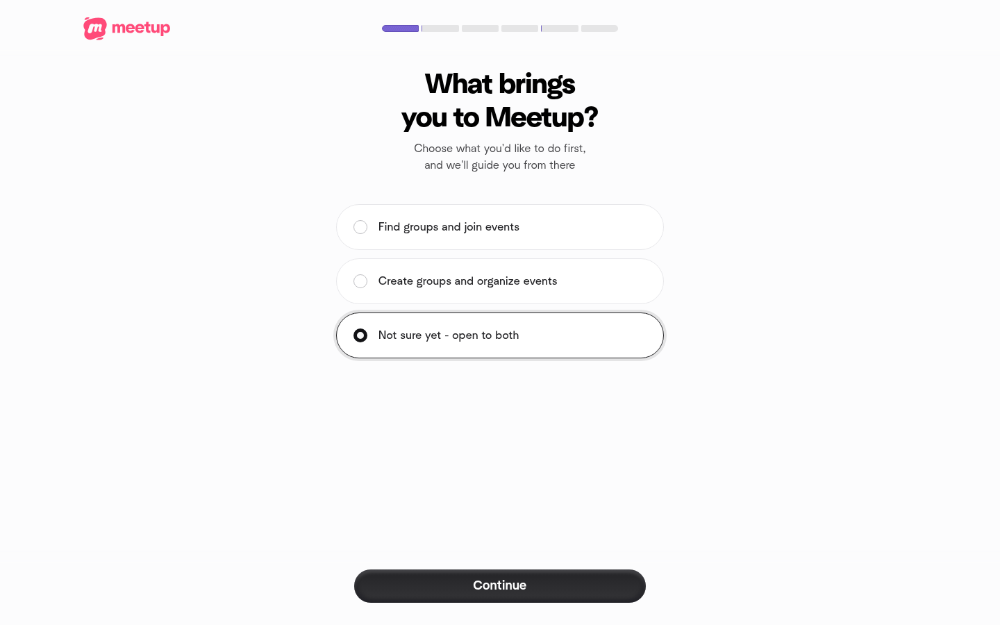

2. **Steps 2–4 — Organizer Value Proposition Carousel (`/welcome/organizer-intro-1`, `-2`, `-3`)**
   - Shown when the user selects *"To create a group"* or *"Both"*.
   - **Screen 1 (`/welcome/organizer-intro-1`)**: *"Empower your community with Meetup"* — highlights 64+ million members (`05_welcome_organizer_intro_1.png`).
   - **Screen 2 (`/welcome/organizer-intro-2`)**: *"Event management made easy"* — highlights ticketing, attendance, and chat tools (`06_welcome_organizer_intro_2.png`).
   - **Screen 3 (`/welcome/organizer-intro-3`)**: *"Turn your passion into profit"* — highlights ticket fees, member dues, and sponsorships (`07_welcome_organizer_intro_3.png`).

   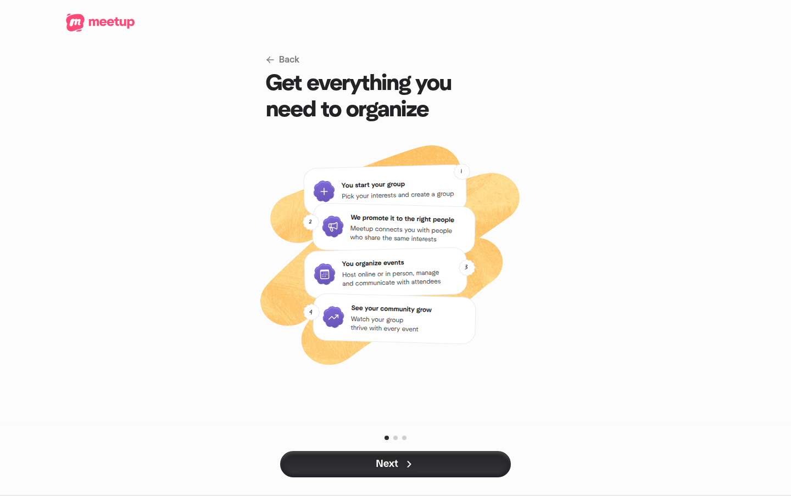

3. **Step 5 — `/welcome/goal` ("What is your main goal on Meetup?")**
   - **UI Controls**: Multi-select pill chips (`Make new friends`, `Find a community`, `Practice a hobby`, `Build a professional network`, `Date or find a partner`, `Learn something new`, `Have fun`, `Explore the city`) + a `+ Something else` button that reveals a custom text input modal/field.
   - **GraphQL Mutation**: `updateMemberData(input: {lookingFor: [...]})`
   - **Screenshots**:
     - Default state: [`08_welcome_goal.png`](./screenshots/08_welcome_goal.png)
     - Multiple chips selected: [`08b_welcome_goal_chips_selected.png`](./screenshots/08b_welcome_goal_chips_selected.png)
     - Custom goal input (`+ Something else` -> `"AI Engineering"`): [`08c_welcome_goal_custom_input.png`](./screenshots/08c_welcome_goal_custom_input.png)

   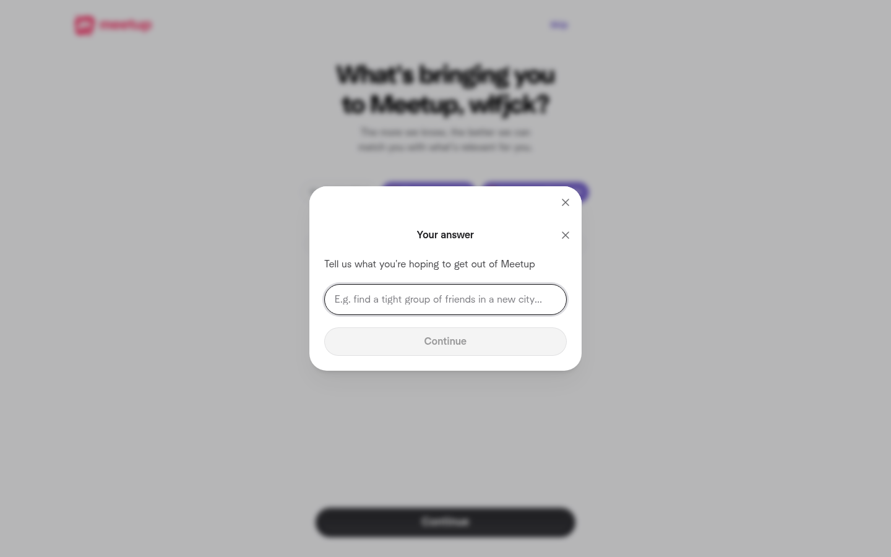

4. **Step 6 — `/welcome/people` ("Who are you hoping to meet?")**
   - **UI Controls**: Multi-select persona chips (`People my age`, `Locals`, `Newcomers in town`, `Expats`, `Single people`, `Couples`, `Young professionals`, `Parents`, `LGBTQ+`, `Women only`, `Men only`, `Anyone`) + `+ Something else`.
   - **Screenshots**: [`09_welcome_people.png`](./screenshots/09_welcome_people.png), [`09b_welcome_people_chips_selected.png`](./screenshots/09b_welcome_people_chips_selected.png)

5. **Step 7 — `/welcome/hangout` ("How do you like to hang out?")**
   - **UI Controls**: Multi-select activity chips (`Coffee or tea`, `Drinks or dinner`, `Outdoor walks & hikes`, `Board games or trivia`, `Workshops & classes`, `Sports & fitness`, `Arts & culture`, `Live music`, `Online events`, `Coworking`, etc.).
   - **Screenshots**: [`10_welcome_hangout.png`](./screenshots/10_welcome_hangout.png), [`10b_welcome_hangout_chips_selected.png`](./screenshots/10b_welcome_hangout_chips_selected.png)

6. **Step 8 — `/welcome/interests` ("Pick at least 3 interests")**
   - **UI Controls**: Live search box (`findTopics(query: "AI")`) + expandable topic taxonomy pills. Clicking a parent topic fires `getRecommendedNewTopics(topicIds: [...])` and inserts related child topics inline with a sparkle icon. `Continue` remains disabled until `>= 3` topics are selected, then executes `followTopics`.
   - **Screenshots**:
     - Initial grid: [`11_welcome_interests.png`](./screenshots/11_welcome_interests.png)
     - 4+ topics selected with dynamic child recommendations: [`11b_welcome_interests_selected.png`](./screenshots/11b_welcome_interests_selected.png)
     - Live keyword search (`"AI"`): [`11c_welcome_interests_search.png`](./screenshots/11c_welcome_interests_search.png)

   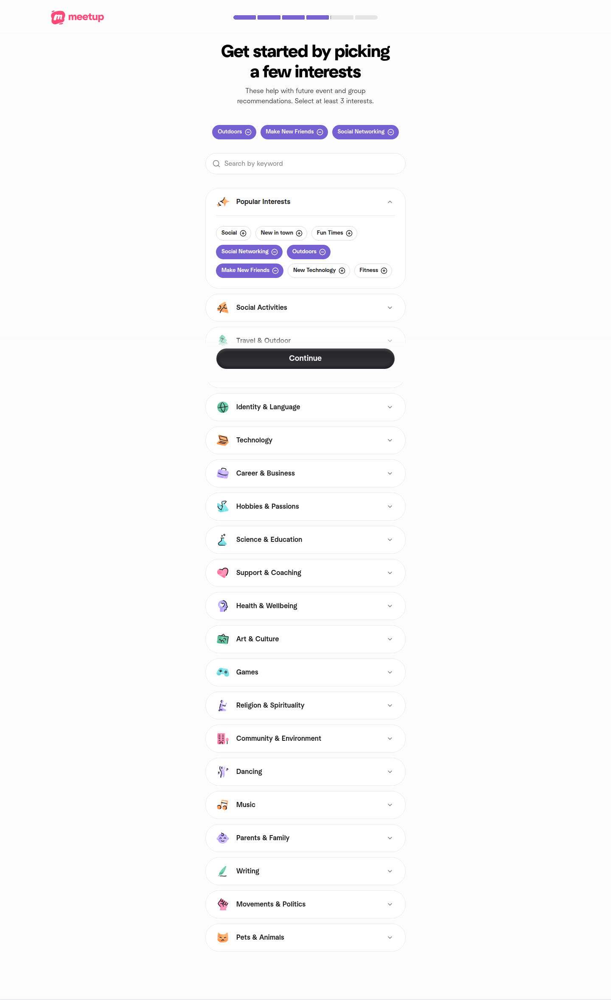

7. **Step 9 — `/welcome/age` ("When is your birthday?")**
   - **UI Controls**: 3 numeric fields (`MM`, `DD`, `YYYY`) with client-side date validation and age verification (must be 18+).
   - **States Tested**:
     - Empty initial state: [`12_welcome_age.png`](./screenshots/12_welcome_age.png)
     - Invalid date error state (`99 / 99 / 2025` -> validation error): [`12b_welcome_age_invalid.png`](./screenshots/12b_welcome_age_invalid.png)
     - Valid adult birthdate (`05 / 15 / 1993`): [`12c_welcome_age_valid.png`](./screenshots/12c_welcome_age_valid.png)

   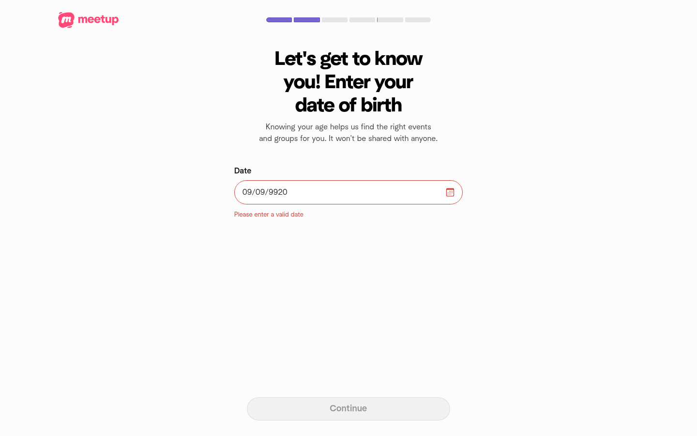

8. **Step 10 — `/welcome/gender` ("What is your gender?")**
   - **UI Controls**: Radio cards (`Woman`, `Man`, `Non-binary`, `Prefer not to say`) + public visibility disclosure.
   - **Screenshots**: [`13_welcome_gender.png`](./screenshots/13_welcome_gender.png), [`13b_welcome_gender_selected.png`](./screenshots/13b_welcome_gender_selected.png)

9. **Steps 11 & 12 — `/welcome/sms-number` & `/welcome/whatsapp-number`**
   - **UI Controls**: Country prefix selector combobox (`US +1` default, searchable list of international dial codes) + phone number input + `Skip` / `Send code` actions.
   - **Screenshots**: [`14_welcome_sms_number.png`](./screenshots/14_welcome_sms_number.png), [`14b_welcome_sms_country_dropdown.png`](./screenshots/14b_welcome_sms_country_dropdown.png), [`15_welcome_whatsapp_number.png`](./screenshots/15_welcome_whatsapp_number.png)

10. **Step 13 — `/welcome/intro-paywall` (Meetup+ Onboarding Upsell)**
    - **UI Controls**: Interactive `Free trial enabled` switch (`role="switch"`), `Yearly (Save 25%)` vs `Monthly` billing plan cards, feature showcase carousel, `Start 7-day free trial` primary CTA, and `Continue with free plan` secondary bypass link.
    - **Screenshots**: [`16_welcome_intro_paywall.png`](./screenshots/16_welcome_intro_paywall.png), [`16b_welcome_intro_paywall_toggled.png`](./screenshots/16b_welcome_intro_paywall_toggled.png)

    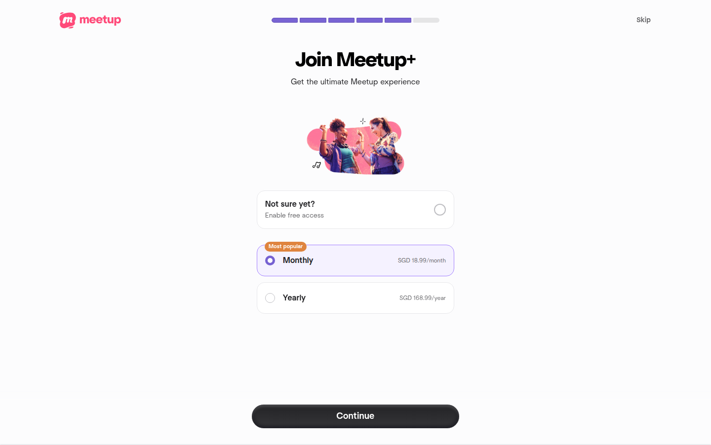

11. **Step 14 — `/welcome/groups` ("Join groups in your area")**
    - **UI Controls**: Grid of recommended local groups (`onboardingSuggestedGroups`) based on the user's selected topics and coordinates, with one-click `+ Join` / `Joined` toggle buttons (`joinGroup` mutation). Clicking `Finish` fires `recordMemberAction(input: {action: "onboarding_completed"})` and redirects to `/home/`.
    - **Screenshots**: [`17_welcome_groups.png`](./screenshots/17_welcome_groups.png), [`17b_welcome_groups_joined.png`](./screenshots/17b_welcome_groups_joined.png), [`18_post_onboarding_landing.png`](./screenshots/18_post_onboarding_landing.png)

---

### 4.2 Feature 2: Global Header, Dual Typeahead Search, Stateful CTAs & Footer

Every authenticated Meetup page shares a sticky `ds2` top navigation header and a dark-themed global footer.

#### Global Header Interactive Elements
1. **Meetup Brand Logo Hover Morph (`Homepage` Pill)**:
   - Hovering over the Meetup script logo in the top-left smoothly morphs it into a pill button reading `Homepage` with a home icon (`26b_header_logo_hover_homepage.png`).
2. **Dual Search Pill (`search-events-input` + `location-typeahead-header-search`)**:
   - **Left Half (Keyword Search)**: Clicking `Search events` opens a floating popover (`data-radix-popper-content-wrapper`) displaying **Recent Searches** and **Popular Searches** (`22_header_search_focused_dropdown.png`). Typing `"Python"` triggers live debounced typeahead suggestions (`python`, `python programming`, `monty python`, `data science using python`) (`23_header_search_typeahead_python.png`).
   - **Right Half (Location Search)**: Displays current city (`San Francisco, CA` / `San Francisco, US`) with a coral search submit button (`data-testid="location-search-submit"`). Typing a city queries `getLocationSearch` and renders matching city/ZIP options.
3. **Stateful Organizer CTA (`Start a new group` vs. `Finish your group`)**:
   - When the user has no group draft (`getGroupDraft === null`), the header displays `Start a new group` with a green `30% off` badge.
   - Once the user begins a group draft in `/start/`, the header dynamically switches across all pages to `Finish your group | 30% off` (`67_self_member_profile_page.png`).
4. **Monetization Upsell Pill (`Try Meetup+` / `Try Pro | Free`)**:
   - Adapts contextually based on user segment (`Try Meetup+ | Free` opens the Meetup+ trial modal/checkout; `Try Pro | Free` links to Meetup Pro).
5. **Quick Navigation Icon Bar**:
   - **Connections** (`/friends/`)
   - **Messages** (`/messages/`)
   - **Notifications** (`/notifications/`)
   - **Your Events** (`/your-events/`)
   - **Your Groups** (`/groups/`)
6. **Profile Avatar Menu (`W` Avatar Button)**:
   - Clicking the circular member initial button opens a Radix dropdown menu (`role="menu"`) containing:
     - Member Header (`wlfjck`, `View profile` -> `/members/484670701/`)
     - `Your events` (`/your-events/`)
     - `Your groups` (`/groups/`)
     - `Saved events` (`/your-events/?type=saved`)
     - `Account settings` (`/account/`)
     - `Help` (`https://help.meetup.com/hc`)
     - `Log out` (`/logout/`)
   - **Screenshot**: [`26_header_profile_dropdown_menu.png`](./screenshots/26_header_profile_dropdown_menu.png)

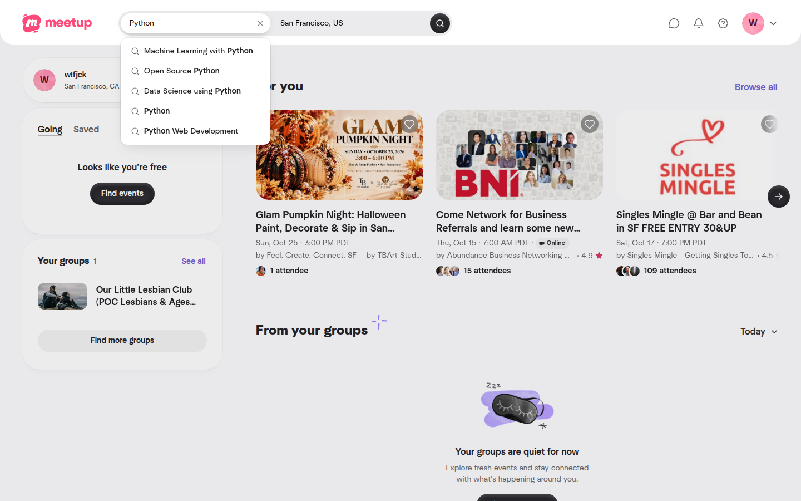
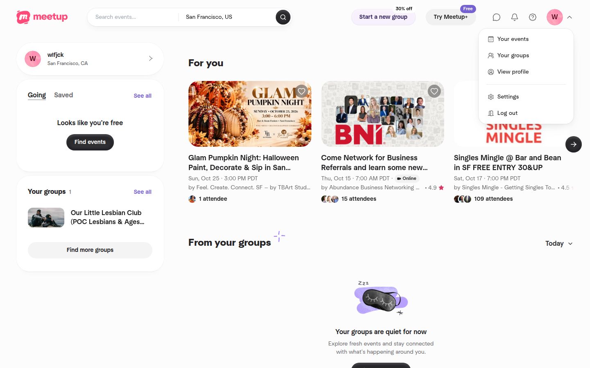

---

### 4.3 Feature 3: Personalized Home Dashboard (`/home/`) & Event Card Actions

#### Functional Layout & State Combinations
- **Hero Banner**: *"All the events you'll love, right here — Curated picks from groups you're in and topics you follow."*
- **Upcoming Event Banner ("Your next event")**:
  - Before RSVP'ing to any event, `/home/` displays only the discovery feed (`20_home_dashboard_viewport.png`).
  - Once the member RSVPs to an event, `/home/` injects a prominent **Your next event** section at the top with a live countdown badge (`In 2 days`), date/time, venue, group link, and `You are going` status badge (`20b_home_with_upcoming_event.png`).
- **Interactive Horizontal Date Strip & Calendar Picker**:
  - Under **Events for you**, a horizontal date strip allows one-click filtering by `All upcoming`, `Today`, `Tomorrow`, or specific upcoming dates (`Oct 15`–`Oct 24`), plus a month/year calendar popover (`Oct 2026`).
- **Feed Filter Pills**:
  - `All` | `From your groups` | `Saved` (`0` / `1`) + `Explore more events` link to `/find/`.
- **Event Card Micro-Interactions**:
  - **Bookmark / Save Toggle**: Clicking the ribbon icon on any event card fires `saveEvent(input: {eventId})` and updates the `Saved` pill counter (`28_home_event_saved_state.png`).
  - **Share Event Modal & Flyer Studio**: Clicking the share icon on an event card opens the `Share this event` dialog (`role="dialog"`), offering:
    - Social share buttons (`Facebook`, `WhatsApp`, `LinkedIn`, `Email`, `Copy link`)
    - **Share a flyer**: 3 auto-generated promotional graphics (`Story 9:16`, `Square 1:1`, `Landscape`) with one-click PNG download buttons (`27_home_event_share_modal.png`).
  - **Try Meetup+ Modal**: Clicking `Try Meetup+` opens the full Meetup+ promotional dialog (`29_try_meetup_plus_modal_or_page.png`).

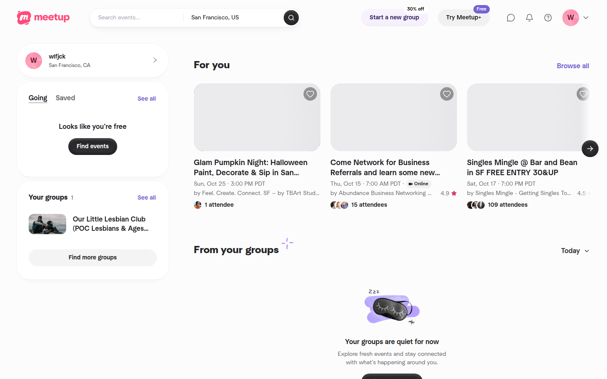
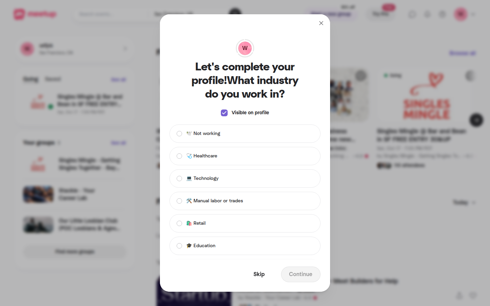
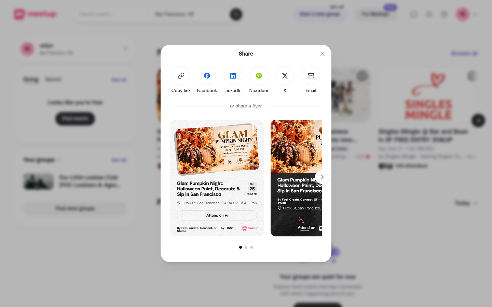

---

### 4.4 Feature 4: Event & Group Discovery Engine (`/find/`, `/topics/`, `/cities/`)

#### 4.4.1 `/find/` — Unified Search & Filter Architecture
The `/find/` page is Meetup's core discovery surface, powered by `eventSearchWithSeries`, `recommendedEventsWithSeries`, and `groupSearch`.

1. **Primary Mode Switcher**:
   - **Events Tab** (`?source=EVENTS`): Displays event cards with date/time, host badge, attendee avatars, venue/online badge, price (`Free` or ticket price), Share, and Save buttons (`34_find_events_default.png`, `35_find_events_full.png`).
   - **Groups Tab** (`?source=GROUPS`): Displays community group cards (`14,315 members`, star rating `4.5 (5,039)`, activity badge `Very Active`, description preview) (`42_find_groups_tab.png`, `42b_find_groups_full.png`).
2. **Four Filter Popover Menus (`data-testid="RevampedFilterButton*"`)**:
   - **Date Filter (`RevampedFilterButtonTime` — "Day")**:
     - Radio options: `Any day`, `Starting soon`, `Today`, `Tomorrow`, `This week`, `This weekend`, `Next week`, `Custom` + `Reset` / `Apply` (`36_find_filter_day_dropdown.png`).
     - Selecting `Custom` expands an interactive dual-month calendar range picker inside the popover (`36b_find_filter_day_custom_calendar.png`).
   - **Group / Attendee Size Filter (`RevampedFilterButtonAttendeeCount` — "Size")**:
     - Multi-select checkboxes: `< 10 attendees`, `10 - 20 attendees`, `20 - 50 attendees`, `50 - 100 attendees`, `> 100 attendees` (`37_find_filter_size_dropdown.png`).
   - **Event Venue Type Filter (`RevampedFilterButtonVenue` — "Venue")**:
     - Radio options: `All venues`, `In person`, `Online` (`38_find_filter_venue_dropdown.png`).
   - **Geographic Radius Filter (`RevampedFilterButtonDistance` — "Distance")**:
     - Radio options: `Any distance`, `2 miles`, `5 miles`, `10 miles`, `25 miles`, `50 miles`, `100 miles` (`39_find_filter_distance_dropdown.png`).
3. **22 Horizontal Category Filter Chips**:
   - `All events`, `New Groups`, `Social Activities` (`652`), `Hobbies & Passions` (`612`), `Support & Coaching` (`774`), `Travel & Outdoor` (`773`), `Technology` (`546`), `Career & Business` (`405`), `Health & Wellbeing` (`511`), `Sports & Fitness` (`684`), `Art & Culture` (`521`), `Games` (`535`), `Pets & Animals` (`701`), `Dancing` (`412`), `Science & Education` (`436`), `Writing` (`467`), `Music` (`395`), `Parents & Family` (`673`), `Identity & Language` (`622`), `Community & Environment` (`604`), `Movements & Politics` (`642`), `Religion & Spirituality` (`692`).

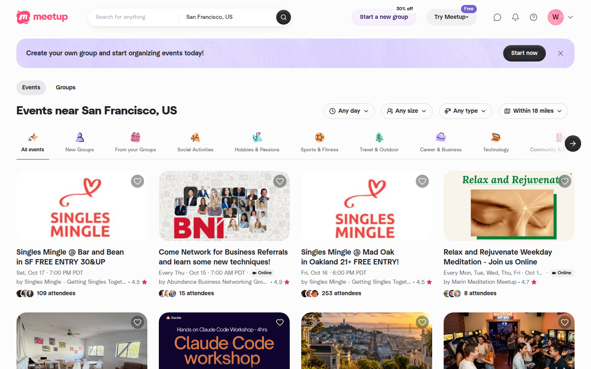
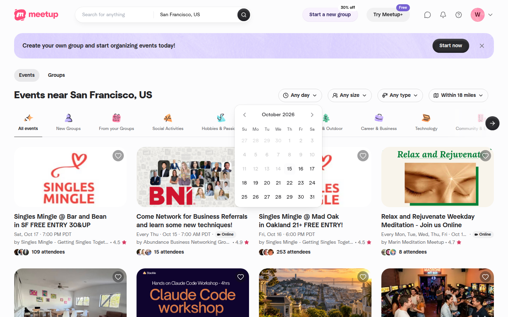
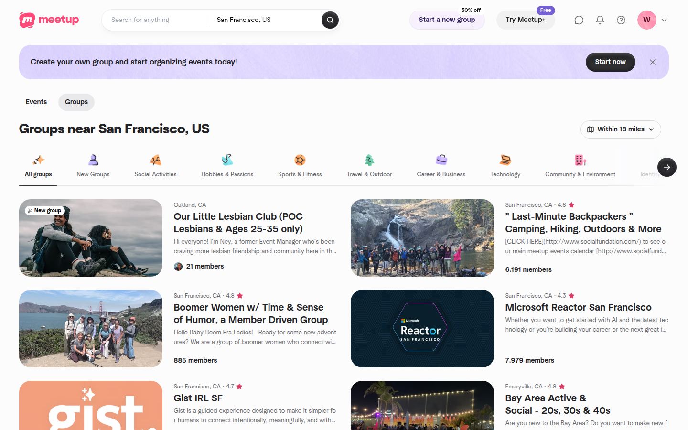

#### 4.4.2 Specialized Discovery Directories
- **Online Events Directory (`/find/online-events/`)**: Curated hub for virtual events hosted via Zoom/Meetup Online (`43_find_online_events.png`).
- **Topics Directory (`/topics/` & `/topics/[topicUrlkey]/`)**:
  - `/topics/` organizes all Meetup topics under 21 illustrated category sections (`44_topics_directory.png`).
  - `/topics/artificial-intelligence/` displays global AI topic statistics, follower count, largest AI Meetup groups worldwide, and upcoming AI events (`45_topic_landing_ai.png`).
- **Cities Directory (`/cities/` & `/find/us--ca--san-francisco/`)**:
  - `/cities/` provides geolocation-aware city discovery (`46_cities_directory.png`).
  - `/find/us--ca--san-francisco/` renders a dedicated city landing page with local category pills, popular local groups, and upcoming city events (`46b_city_landing_san_francisco.png`).

---

### 4.5 Feature 5: Event Detail Page, RSVP Workflows, Flyer Studio & Attendees Directory

We tested both an **In-Person Event** (`/singles-mingle-getting-people-together/events/316287001/` — *"Singles Mingle @ Bar and Bean in SF FREE ENTRY 30&UP"*) and an **Online Meetup Pro Event** (`/stackle-your-career-lab/events/316515278/` — *"Why Everything You Know About Finding a Job Is Wrong"*).

#### 4.5.1 Event Detail Layout & Interactive Controls
- **Hero Header**: Event title, Group card with star rating (`4.5 • 5,039 ratings`), Host avatar (`Hosted by Adeline`), and top action pills (`Share`, `Save`).
- **Details & Logistics Column**:
  - Expandable description with `Read more` / `Show less` toggle (`47_event_detail_inperson_viewport.png` -> `47c_event_detail_read_more_expanded.png`).
  - Topic tags (`Singles`, `Single Professionals`, `New In Town`, `Dining Out`, `Social`).
  - **Event Chat Promo Card**: Prompts attendees to join the event chat in the Meetup mobile app.
  - **Report Event Workflow (`Report event` button)**: Opens a two-step safety modal (`Why are you reporting this event?` with radio options: `Spam or scam`, `Hate speech or harassment`, `Violence or dangerous behavior`, `Nudity or sexual content`, `Intellectual property violation`, `Something else`) (`47e_event_report_modal.png`).
- **Right Sticky Sidebar**:
  - Date & Time block with timezone (`Sunday, Oct 18 · 6:00 PM to 9:00 PM PDT`).
  - Venue block (`Bar and Bean`, address `1834 Divisadero St · San Francisco, CA`) + embedded interactive **Leaflet / OpenStreetMap** map widget (or `Online event` link hidden until RSVP for virtual events, `48_event_detail_online_full.png`).
  - **Attendees Preview Card**: Shows count (`Going (6)`), avatar stack, and `See all` link to `/attendees/`.
  - **Share a Flyer Card**: Clicking `Share a flyer` opens a dedicated modal (`47d_event_share_flyer_modal.png`) with 3 downloadable branded flyers for Instagram/WhatsApp/LinkedIn.
- **Sticky Bottom Action Bar**:
  - Displays event date/time, title, price (`Free`), `Share`, `Save`, and the primary `Attend` / `Attend online` CTA button.

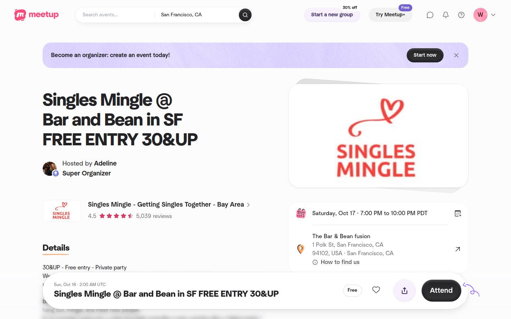
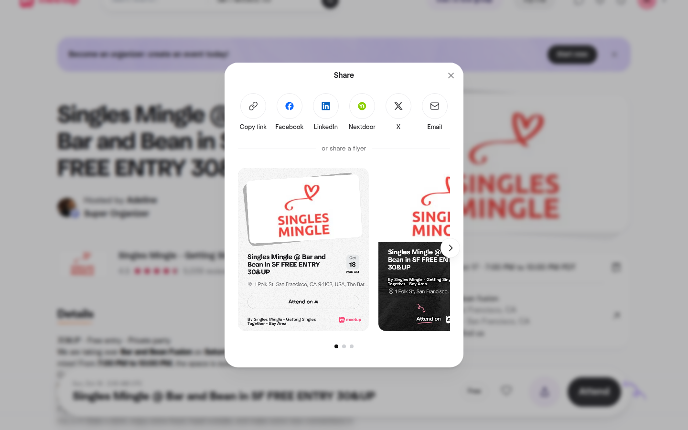
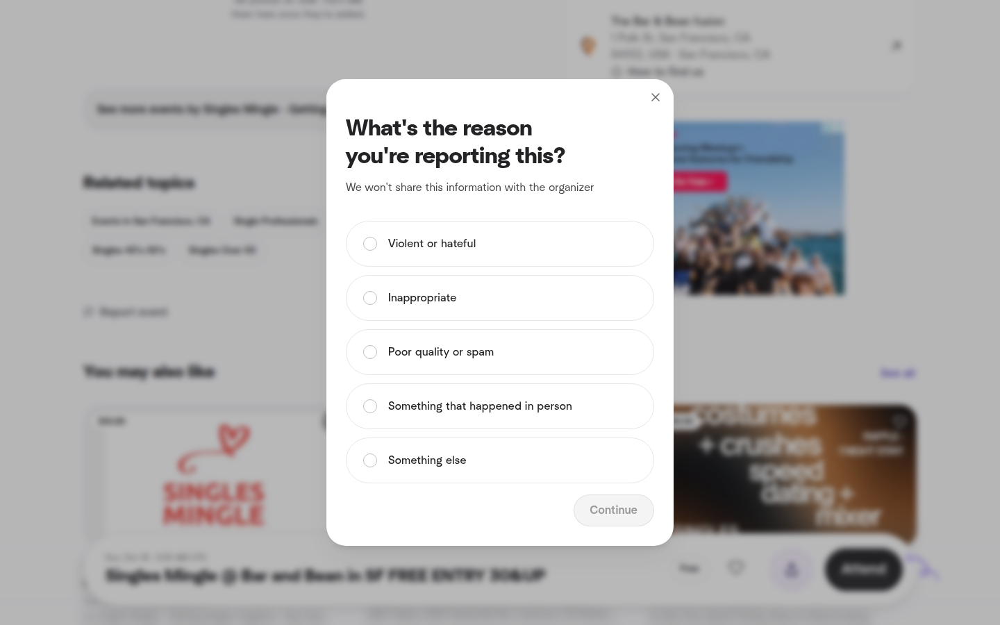

#### 4.5.2 Multi-Variant RSVP Workflows (`rsvpToEvent` Mutation)
We discovered and tested **two distinct pre-RSVP confirmation dialogs** depending on group type and guest settings:
1. **Meetup Pro Email-Sharing Consent Dialog** (tested on `/stackle-your-career-lab/events/316515278/`):
   - Because `Stackle - Your Career Lab` is part of a **Meetup Pro Network**, clicking `Attend online` opens a modal titled *"Share your email with Stackle - Your Career Lab"* with radio options (`Share my email` vs. `Don't share my email`) before executing `rsvpToEvent(input: {eventId: "316515278", response: "YES", optToShareEmail: true})` (`49_event_rsvp_confirmation_modal.png`).
2. **In-Person Guest Count Dialog** (tested on `/singles-mingle-getting-people-together/events/316287001/`):
   - Because the organizer allows up to 2 guests per attendee, clicking `Attend` opens a modal titled *"Finish your RSVP — Are you bringing anyone?"* with a segmented counter (`0` | `+1` | `+2`) and `Submit` button (`49d_inperson_event_rsvp_confirmation.png`).
3. **Post-RSVP Confirmation Modal & "You Are Going!" State**:
   - Submitting the RSVP fires:
     1. `joinGroup` (auto-joins the user to the hosting group if not already a member)
     2. `rsvpToEvent(input: {eventId: "316287001", response: "YES", guestsCount: 0})`
     3. `getPostRsvpRecommendations`
   - Opens the confirmation modal (`You're going!`) with `Add to calendar` options and recommended similar events (`49f_event_rsvp_submitted_confirmation.png`).
   - Updates the sticky bottom bar to **`You are going! · Edit RSVP`** (`49g_event_detail_you_are_going_bar.png`).

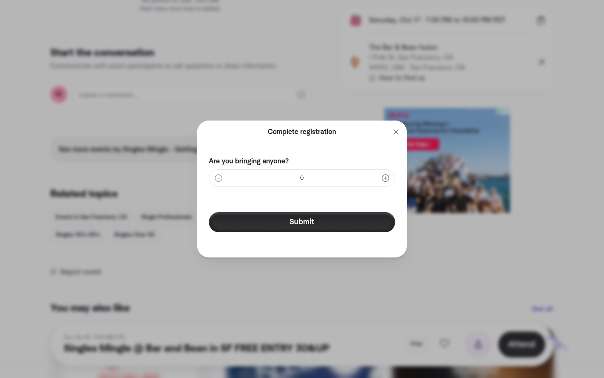
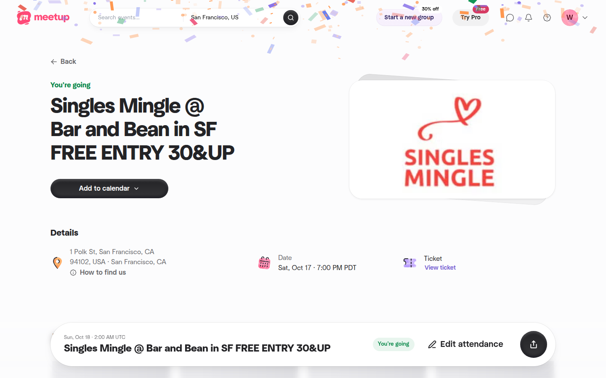
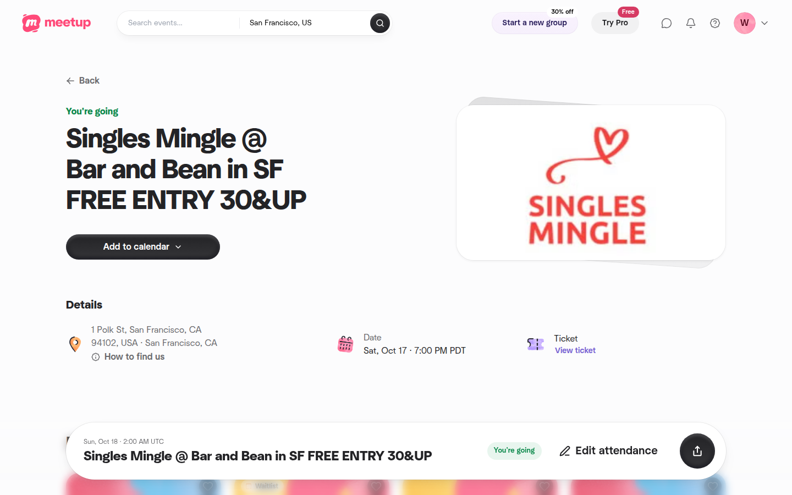

#### 4.5.3 Event Attendees Directory (`/[groupUrlname]/events/[eventId]/attendees/`)
- **Meetup+ Gate**: Navigating directly to `/attendees/` automatically triggers a Meetup+ upsell dialog (`See full attendee lists and profiles`), which can be dismissed via `Continue with free plan`.
- **Interactive Controls**:
  - **Tabs**: `Going (6)` vs. `Canceled (3)` (`50_event_attendees_clean.png`, `50c_event_attendees_canceled_tab.png`).
  - **Search Input**: Filter attendees by name (`Search attendees`).
  - **Sort Dropdown**: `Host first` | `Relevance` | `Name` | `RSVP date` (`50b_event_attendees_sort_dropdown.png`).
  - **Attendee Cards**: Avatar, name, role badge (`Host` / `Organizer` / `Member`), and shared group interests.

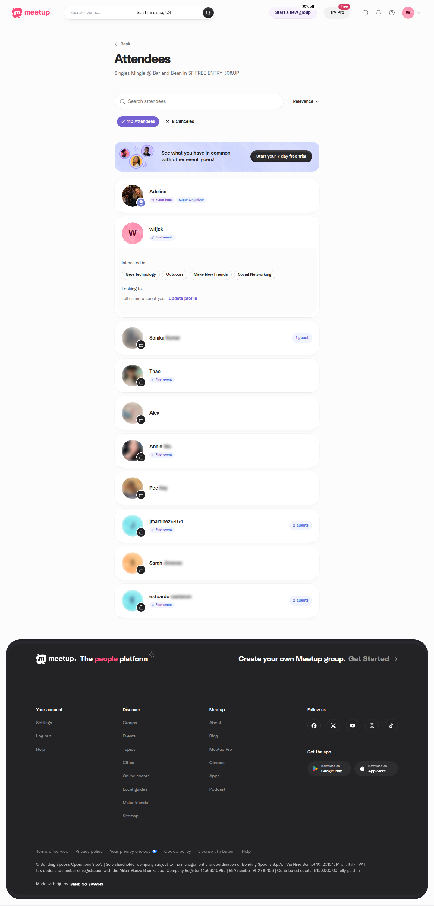

---

### 4.6 Feature 6: Personal Event Schedule & Calendar Export (`/your-events/`)

- **URL**: `https://www.meetup.com/your-events/`
- **Layout**:
  - **Left Sidebar Navigation**:
    - Filter links: `Attending` / `Going`, `Saved`, `Past`, `Hosting`.
    - **Interactive Mini-Calendar Widget**: Month/Year grid (`October 2026`) highlighting dates with scheduled RSVPs; clicking any date scrolls/filters the event list to that date.
  - **Main Content Area**:
    - **Empty State**: Shows illustration + *"No upcoming events"* + `Explore events` CTA (`30_your_events_attending.png`).
    - **Populated `Going` State**: Shows the user's upcoming RSVP (`Singles Mingle @ Bar and Bean in SF FREE ENTRY 30&UP`) grouped by date (`Sunday, October 18, 2026`) with `Going` badge (`30c_your_events_populated_going.png`).
    - **Populated `Saved` State**: Shows bookmarked events with one-click RSVP or unsave (`31_your_events_saved.png`).
    - **`Past` Tab**: Historical archive of attended events (`32_your_events_past.png`).
    - **`Add to calendar` Modal**: Clicking `Add to calendar` opens a modal with **Google Calendar**, **iCal / Apple Calendar (`.ics`)**, and **Outlook** export links (`30b_your_events_add_to_calendar.png`).

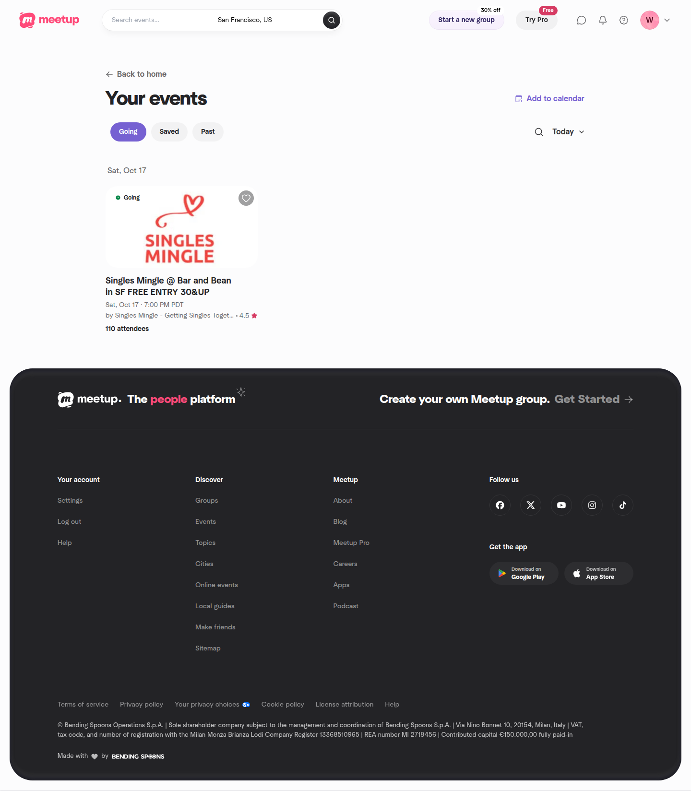
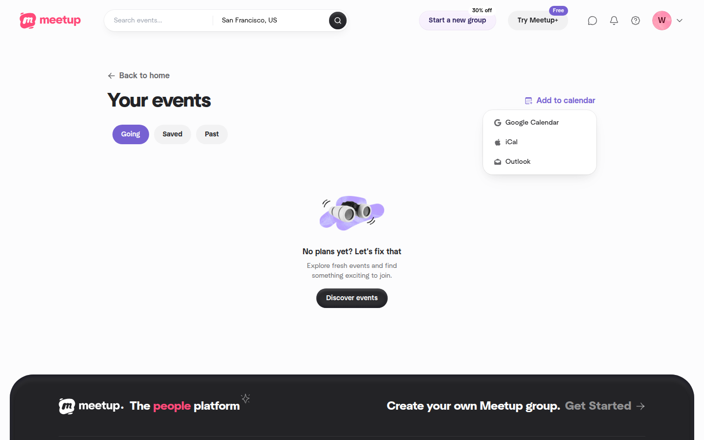

---

### 4.7 Feature 7: Community Groups Hub & Group Detail Ecosystem (`/[groupUrlname]/*`)

#### 4.7.1 Your Groups Hub (`/groups/`)
- Displays all groups the member belongs to (`Member (3)` tab vs. `Pending` tab) with group cover photos, member counts, organizer status, and a bottom discovery section (`Suggested groups near you`) (`51_your_groups_page.png`).

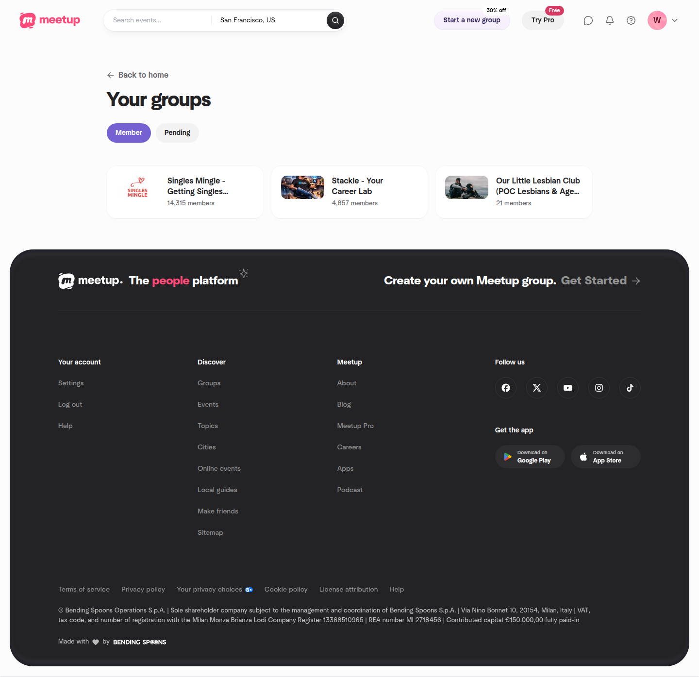

#### 4.7.2 Group Detail Page (`/singles-mingle-getting-people-together/`)
A comprehensive community portal featuring a hero banner, metadata bar (`4.5 • 5,039 ratings | Livermore, CA, USA | 14,315 members | Public group`), Organizer attribution, and 5 primary navigation tabs + 2 action buttons (`Donate` and `Manage membership` / `Join this group`):

1. **`About` Tab (`/[groupUrlname]/`)**:
   - Group description (`What we're about`), upcoming events preview, recent photos preview, organizer card, member avatar grid, and **Member Feedback** overview (`4.5` stars across `5,039 ratings` with aspect pills: `Engaging host 1861`, `Welcoming community 1445`, `Expectations met 1236`, `Valuable information 402`, `Attend again 118`) (`52_group_detail_about_viewport.png`, `52b_group_detail_about_full.png`).
2. **`Events` Tab (`/[groupUrlname]/events/`)**:
   - **Sub-view 1 — `Upcoming` (`/events/`)**: Chronological list of scheduled group events (`53_group_events_upcoming.png`).
   - **Sub-view 2 — `Past` (`/events/past/`)**: Archive of **1,197 past events** with attendee counts and photo album links (`53b_group_events_past.png`).
   - **Sub-view 3 — `Calendar` (`/events/calendar/`)**: Full interactive monthly calendar grid (`October 2026`) with `Today`, `<`, `>` month navigation (`53c_group_events_calendar.png`).
3. **`Members` Tab (`/[groupUrlname]/members/`)**:
   - **Sub-tab 1 — `All members` (`?op=all`)**: Searchable directory of `14,315 members` with sort options (`Sort by: Name / Date joined / Last visited`), showing join date and last visit timestamp (`54_group_members_all.png`).
   - **Sub-tab 2 — `Leadership team` (`?op=leaders`)**: Filtered view of Organizers, Co-Organizers, Assistant Organizers, and Event Organizers (`54b_group_members_leadership.png`).
4. **`Photos` Tab (`/[groupUrlname]/photos/`)**:
   - Displays photo albums grid (`67 photos`) + `Add photos` button (`55_group_photos.png`).
   - **`Add photos` Modal**: Clicking `Add photos` opens a drag-and-drop photo uploader modal (`Upload photos`, `Select from computer`) (`55b_group_add_photos_modal.png`).
   - **Photo Album Detail (`/[groupUrlname]/photos/[albumId]/`)**: Masonry grid of individual event photos with lightbox viewer (`55c_group_photo_album_detail.png`).
5. **`Discussions` Tab (`/[groupUrlname]/discussions/`)**:
   - Community forum board with a `Start a discussion` composer (`Add a title`, `Write a post...`), sort controls (`Pinned & recent` vs. `Most popular`), and threaded posts with like/comment counters (`56_group_discussions.png`).
6. **`Feedback Overview` Page (`/[groupUrlname]/feedback-overview/`)**:
   - Detailed breakdown of all `5,039 ratings`, filterable by `All`, `Reviews`, and `Events` (`58_group_feedback_reviews.png`).
7. **`Manage membership` Dropdown Menu & Group Membership Profile**:
   - Clicking the visible `Manage membership` button opens a menu with 4 actions (`57_group_manage_membership_menu.png`):
     - `Membership details` -> Opens `/members/484670701/group/37485736/` (`66_member_group_profile_details.png`), where the user can view their group-specific join date, edit their **Group Bio / Introduction** (`66c_member_group_profile_edit_bio_modal.png`), and inspect their **Attendance History** in that group.
     - `Group notifications` -> Opens `/account/comm/singles-mingle-getting-people-together/` (`75b_account_comm_group_specific.png`).
     - `Leave this group`
     - `Report this group`

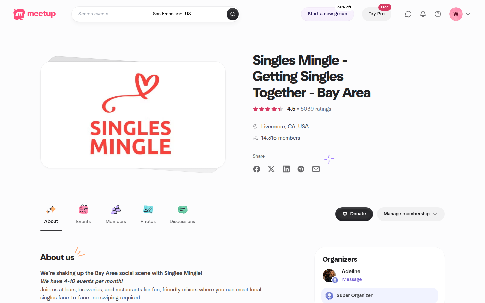
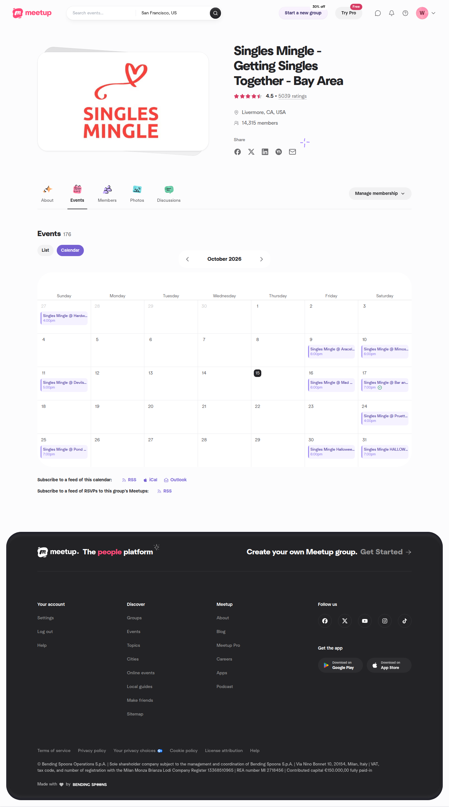
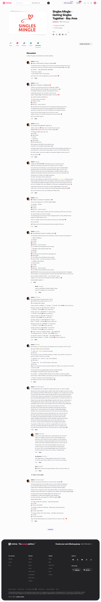
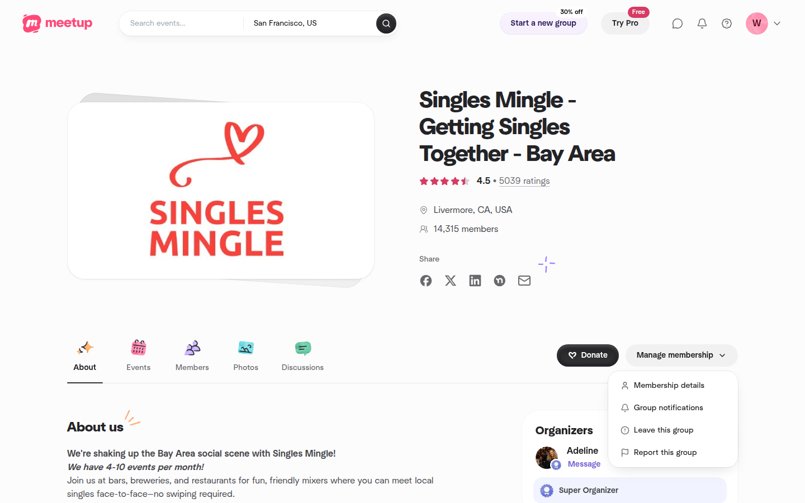
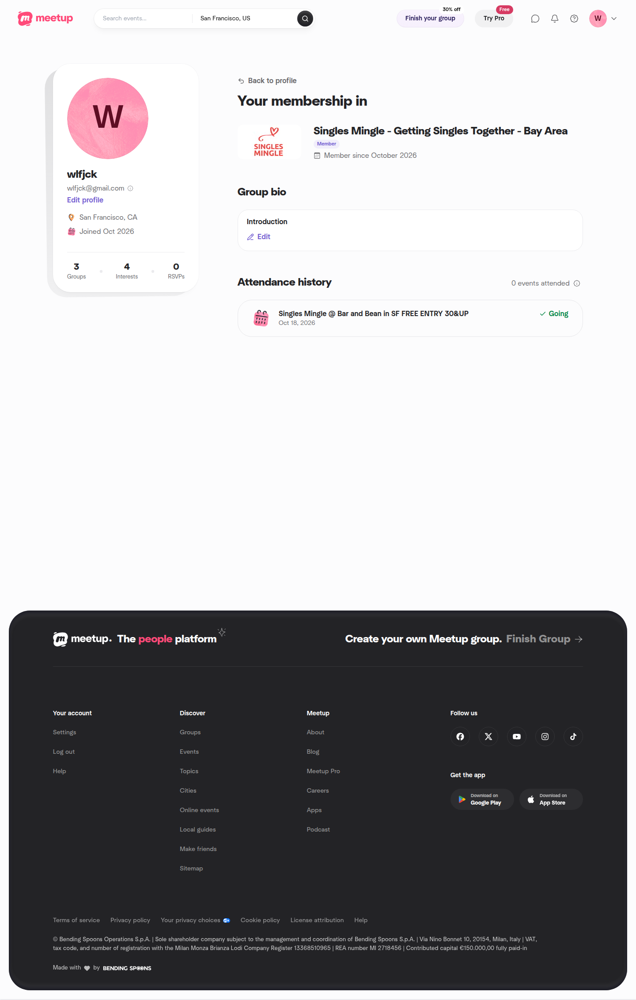

---

### 4.8 Feature 8: 6-Step Group Creation Wizard, AI Description Generator & Organizer Checkout (`/start/`)

Navigating to `https://www.meetup.com/start/` launches Meetup's **6-step Group Creation Wizard**, backed by `getGroupDraft`, `recordMemberAction(action: "group_draft_completed")`, `getGroupStartSubscriptionProfile`, and `checkoutPreview`:

| Step | Wizard Screen | UI Controls & Backend Actions | Screenshot |
| :--- | :--- | :--- | :--- |
| **Step 1** | **Location** (`Choose a location for your group`) | Pre-filled with user's city (`San Francisco, CA`) + `Change location` search input + `Next` button | [`60_start_step1_location.png`](./screenshots/60_start_step1_location.png) |
| **Step 2** | **Topics** (`Choose topics for your group`) | Topic search input + selectable topic pills (`New Technology`, `Outdoors`, `Make New Friends`, `Social Networking`, etc.) + `View more`. Recommends selecting at least 3 topics | [`61_start_step2_topics.png`](./screenshots/61_start_step2_topics.png), [`61b_start_step2_topics_selected.png`](./screenshots/61b_start_step2_topics_selected.png) |
| **Step 3** | **Group Name** (`Name your group`) | Text input (`"San Francisco AI & Cloud Builders Meetup"`) with community review guidance | [`62_start_step3_name.png`](./screenshots/62_start_step3_name.png), [`62b_start_step3_name_filled.png`](./screenshots/62b_start_step3_name_filled.png) |
| **Step 4** | **Description & AI Generator** (`Describe your group`) | Rich textarea + **`Generate Description with AI`** button (uses group name & selected topics to synthesize an organizer description) + collapsible `Tips for a great description` | [`63_start_step4_description.png`](./screenshots/63_start_step4_description.png), [`63b_start_step4_description_filled.png`](./screenshots/63b_start_step4_description_filled.png) |
| **Step 5** | **Plan Selection** (`Choose the best plan for you`) | Billing cycle tabs (`1 month`, `6 months TOP PICK`, `12 months`) + side-by-side feature matrix comparing **Starter** vs **Standard** (`Maximum number of groups`, `Maximum number of events`, `Maximum number of attendees per event`, `Online events`, `Recurring events`, `Ticket fees and member dues`, `Assign unlimited co-organizers`) | [`64_start_step5_guidelines.png`](./screenshots/64_start_step5_guidelines.png) |
| **Step 6** | **Organizer Subscription Checkout** (`/subscription/checkout/core/organizer/`) | Creates draft chapter (`chapterId=38737586`), applies `30% off` promo code (`courtesy-discount-30`), and renders the payment form (`Yearly` / `Every 6 months` / `Monthly`, Credit/Debit card via Stripe Elements or PayPal, Country/Region/Tax ID fields) | [`65_start_step6_organizer_subscription.png`](./screenshots/65_start_step6_organizer_subscription.png) |

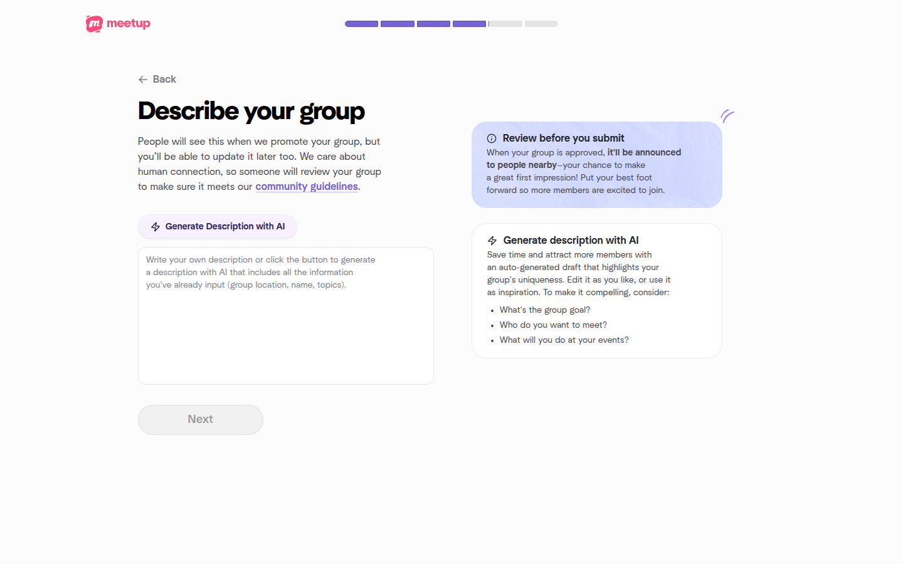
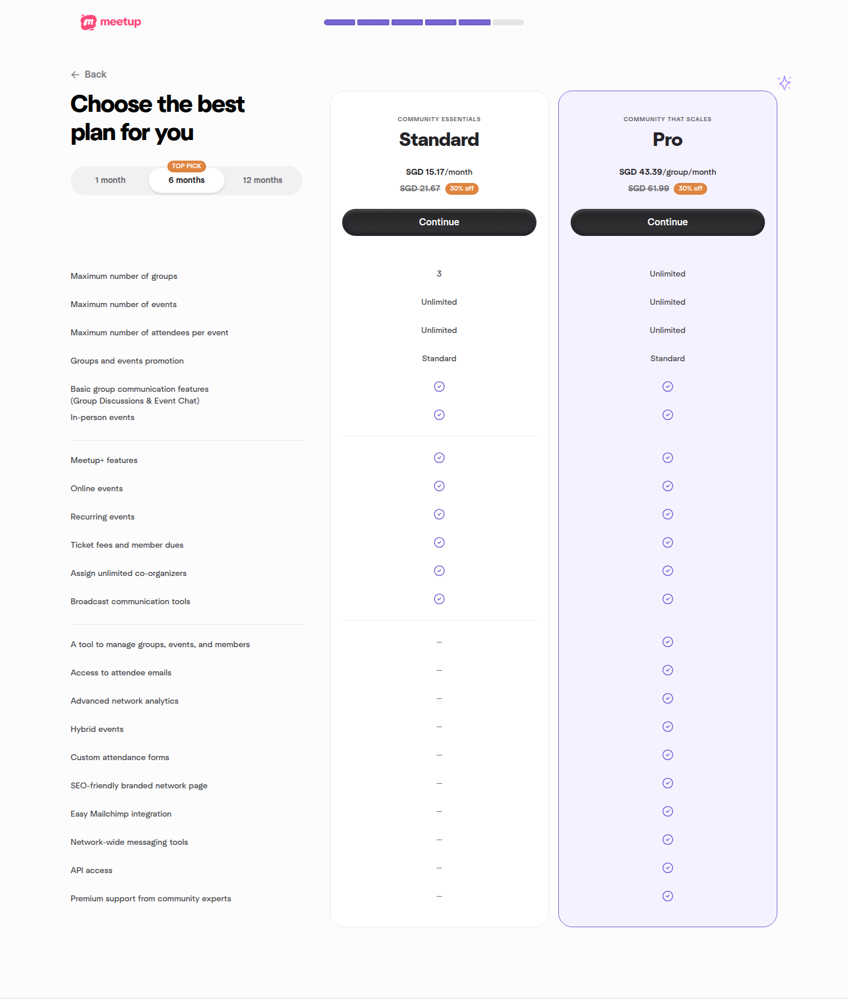
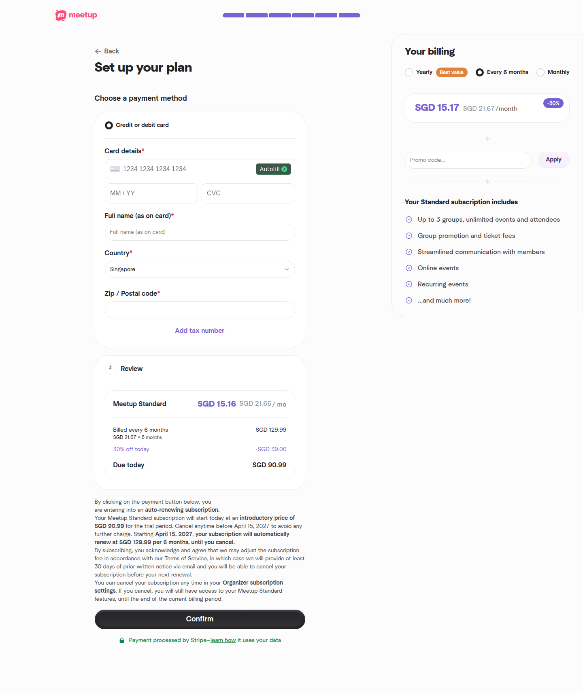

---

### 4.9 Feature 9: Member Profiles, Social Graph, Messaging & Notifications

1. **Self Member Profile (`/members/484670701/`)**:
   - **Left Profile Card**: Avatar initial (`W`), display name (`wlfjck`), email (`wlfjck@gmail.com`), `Edit profile` link (`/account/`), location (`San Francisco, CA`), join date (`Joined Oct 2026`), and counters (`3 Groups`, `4 Interests`, `0 RSVPs`).
   - **Right Content Cards**:
     - `My interests (4)`: Displays followed topic pills (`New Technology`, `Outdoors`, `Make New Friends`, `Social Networking`).
     - `Member (3)`: Lists joined groups (`Singles Mingle`, `Stackle - Your Career Lab`, `Our Little Lesbian Club`) with direct `Membership details` links (`/members/484670701/group/[groupId]/`) and a promotional card (`Find your people. Join a new group near you! -> Explore`).
   - **Screenshot**: [`67_self_member_profile_page.png`](./screenshots/67_self_member_profile_page.png)
2. **Connections / Friends Hub (`/friends/`)**:
   - Dedicated route for managing mutual Meetup connections (`69_connections_friends_page.png`).
3. **Messages Inbox (`/messages/`)**:
   - Two-pane messaging interface with thread list on the left, new conversation composer icon, and empty-state guidance (`"This space is feeling a little... empty. Why not be the first to say hi? Hit that pen icon and slide into a new convo."`) (`70_messages_inbox_page.png`).
4. **Notifications Center (`/notifications/`)**:
   - Displays in-app notifications (`getNotifications` query) with a `Mark all as read` action button, an organizer promo banner (`Organize your own event -> Start now`), and notification feed (`71_notifications_page.png`).

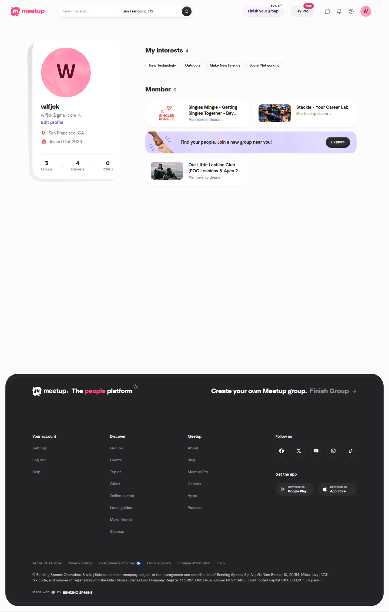
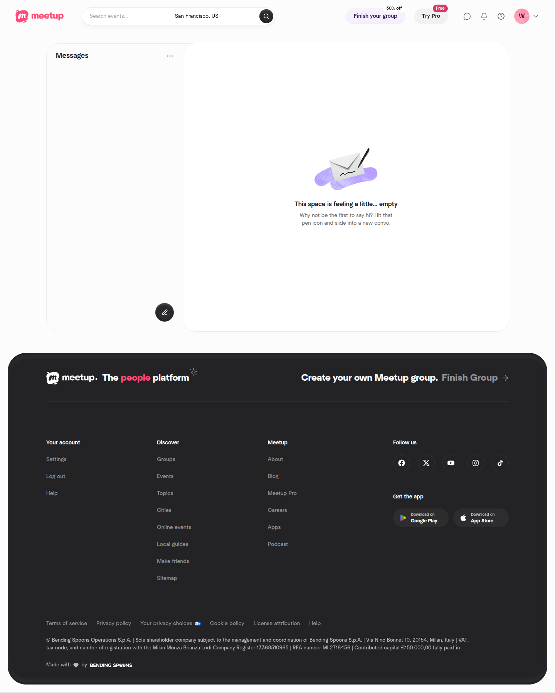
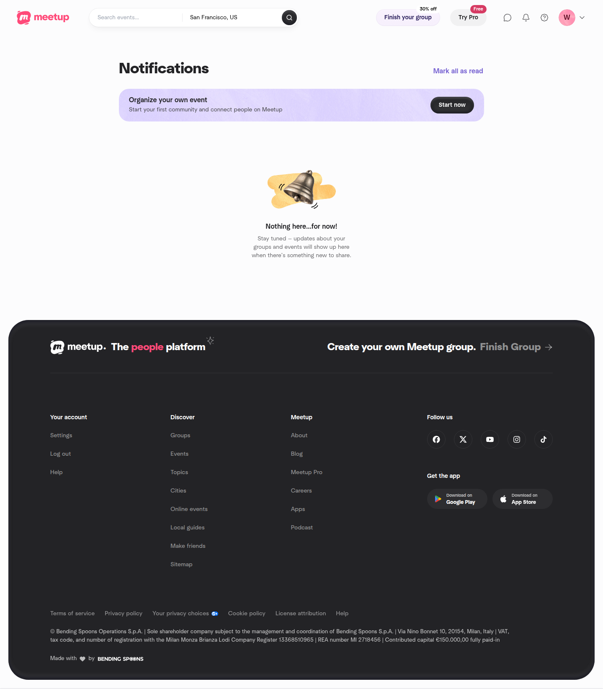

---

### 4.10 Feature 10: Account Settings, Privacy, Granular Email Controls & Payments Ledger (`/account/*`, `/payments/*`)

The Account Settings suite shares a persistent 16-item left navigation sidebar across `/account/*` and `/payments/*`. Every subpage was visited, inspected, and screenshotted:

| # | Settings Page & Route | Functional Controls & Form Fields | Screenshot |
| :--- | :--- | :--- | :--- |
| 1 | **Edit Profile** (`/account/`) | Profile photo uploader, `Name` (`wlfjck`), `Location` (`San Francisco, CA`), `Bio` textarea, and 3 public visibility switches (`Show groups on profile`, `Show interests on profile`, `Show relationship status on profile`) | [`72_account_edit_profile.png`](./screenshots/72_account_edit_profile.png) |
| 2 | **Personal Info** (`/account/personal/`) | Demographics used for personalized recommendations: `Birthdate`, `Gender`, `What are you looking for?` (multi-select), `What's your relationship status?`, `What industry do you work in?`, and `Life stages` | [`73_account_personal_info.png`](./screenshots/73_account_personal_info.png) |
| 3 | **Account Management** (`/account/management/`) | `Your email` (`wlfjck@gmail.com`), `Language` (`English`), `Primary timezone`, `System theme` (`Light` / `Dark` / `System`), `Change your password`, `Deactivate your account`, and **`GDPR Requests`** (Download personal data archive / Request erasure) | [`74_account_management.png`](./screenshots/74_account_management.png) |
| 4 | **Email Updates (Global)** (`/account/comm/`) | `Send fewer emails` master toggle, `Updates from Meetup` (`Messages`, `Replies to my comments`, `Suggested events`, `New Meetup Groups`, `Updates from Meetup HQ`, `Meetup HQ Surveys`, `iCal Attachments`, `Updates from Meetup Pro Networks`, `Connections`), per-group settings links (`Updates from your groups`), and `Turn off all email updates` | [`75_account_email_updates_comm.png`](./screenshots/75_account_email_updates_comm.png) |
| 5 | **Email Updates (Per-Group)** (`/account/comm/[groupUrlname]/`) | Granular per-group notification toggles: `New event announcements`, `My RSVP is confirmed`, `Changes to event time or location`, `New comments`, `Event reminders`, `Event rating requests`, `Event updates from organizers`, `New photos uploaded to event albums`, `Someone tags or comments on my photo`, `Announcement to members about the group`, `Discussion invitations` | [`75b_account_comm_group_specific.png`](./screenshots/75b_account_comm_group_specific.png) |
| 6 | **Privacy** (`/account/privacy/`) | `Who can contact you on Meetup?` (`Anyone on Meetup` vs `Only members of groups I'm in` vs `Only my connections`), `Contacts` upload management, and quick link to public profile visibility settings | [`76_account_privacy.png`](./screenshots/76_account_privacy.png) |
| 7 | **Social Media** (`/account/services/`) | External profile links displayed on the member's Meetup profile: `Facebook`, `Instagram`, `Twitter / X`, `LinkedIn` | [`77_account_social_services.png`](./screenshots/77_account_social_services.png) |
| 8 | **Interests** (`/account/interests/`) | Topic search bar (`Search for more interests`) + removable pills for currently followed topics (`Your interests`) + recommended topics | [`78_account_interests.png`](./screenshots/78_account_interests.png) |
| 9 | **Mobile Notifications** (`/account/mobile/`) | Push notification management & QR/App Store/Google Play download links for iOS and Android | [`86_account_mobile_notifications.png`](./screenshots/86_account_mobile_notifications.png) |
| 10 | **Organizer Subscription** (`/account/subscription/`) | Displays current organizer plan status (`You currently don't have a subscription`) with CTA to start/finish a group | [`80_account_organizer_subscription.png`](./screenshots/80_account_organizer_subscription.png) |
| 11 | **Meetup+ Subscription** (`/account/member-plus/` -> `/subscription/checkout/member-plus/`) | Redirects non-subscribers to the Meetup+ checkout page (`Yearly 25% off` / `Monthly`, `Free for 7 days`, feature list, Stripe card / PayPal checkout form) | [`79_account_member_plus.png`](./screenshots/79_account_member_plus.png) |
| 12 | **Payment Methods** (`/account/payment-methods/`) | Saved credit/debit cards management | [`81_account_payment_methods.png`](./screenshots/81_account_payment_methods.png) |
| 13 | **Payments Made** (`/payments/payments_made/` & `/payments/dues_payments_made/`) | Ledger table with two tabs: **`Event fees`** (`Event date`, `Event`, `Meetup Group`, `Amount`, `Status`) and **`Member dues`** (`Date paid`, `Meetup Group`, `Amount`, `Status`) | [`82_payments_made.png`](./screenshots/82_payments_made.png), [`83_payments_dues_made.png`](./screenshots/83_payments_dues_made.png) |
| 14 | **Payments Received** (`/payments/`) | Organizer revenue dashboard with 4 tabs (`Overview`, `Event fees`, `Member dues`, `Sponsorships`) and summary cards (`Total payments received $0.00`, `Total from event fees $0.00`, `Total from member dues $0.00`, `Total from sponsorships $0.00`) | [`87b_payments_received.png`](./screenshots/87b_payments_received.png) |
| 15 | **OAuth Applications** (`/account/oauth_apps/`) | Connected third-party OAuth applications & developer link to create OAuth clients | [`84_account_oauth_apps.png`](./screenshots/84_account_oauth_apps.png) |

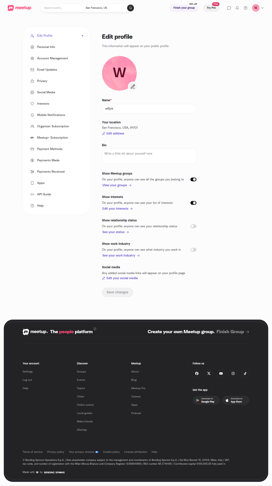
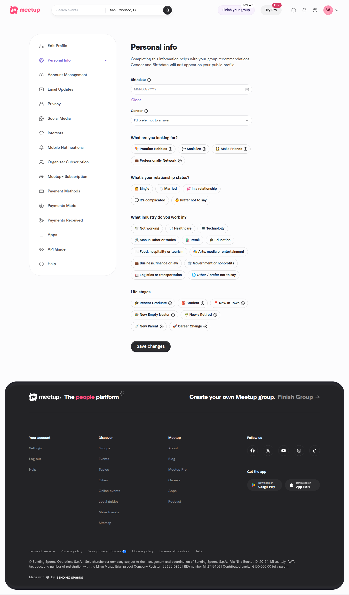
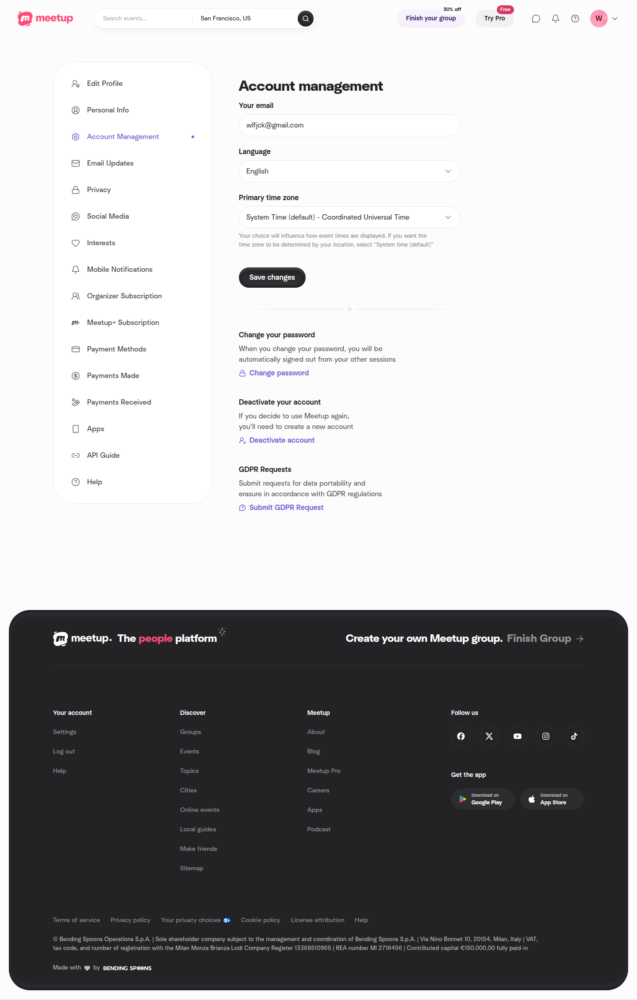
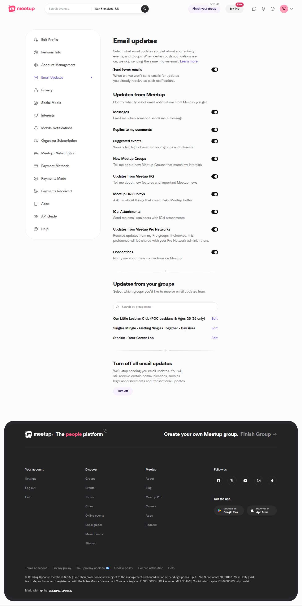
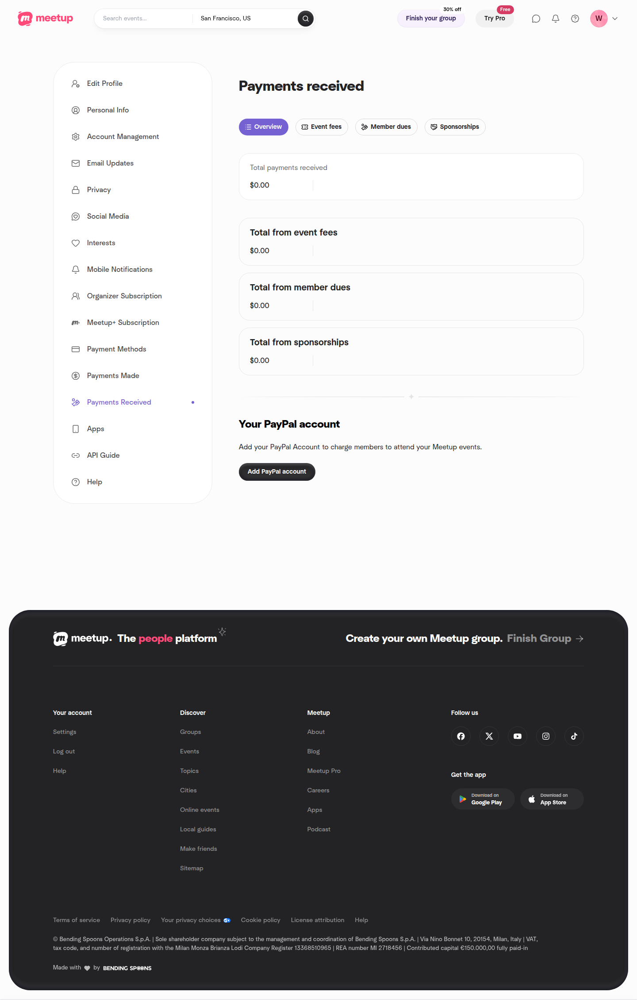

---

### 4.11 Feature 11: Monetization Tiers (Meetup+, Meetup Pro) & Developer GraphQL Portal

#### 4.11.1 Meetup+ (Consumer Subscription Tier)
- **Pricing**: 7-day free trial, then Monthly (`$14.99/mo`) or Yearly (`$129.99/yr`, 25% discount; localized dynamically via `checkoutPreview`, e.g., `SGD 14.08/mo`).
- **Core Entitlements**:
  1. **Full Attendee Lists & Profiles**: Unlocks full visibility on `/[group]/events/[id]/attendees/`.
  2. **Priority Event Access**: Moves subscribers ahead on event waitlists and alerts them first.
  3. **Unlimited Direct Messaging**: Message any Meetup member regardless of shared group/connection rules.
  4. **Exclusive Member Badges & Profile Customization**: Enhanced profile flair and insights.
- **Screenshots**: [`16_welcome_intro_paywall.png`](./screenshots/16_welcome_intro_paywall.png), [`29_try_meetup_plus_modal_or_page.png`](./screenshots/29_try_meetup_plus_modal_or_page.png), [`79_account_member_plus.png`](./screenshots/79_account_member_plus.png)

#### 4.11.2 Meetup Pro (`/meetup-pro/`)
- **Enterprise Multi-Group Network Tier**: Designed for brands, developer relations teams, and global communities managing networks of groups across cities.
- **Features**:
  - Network-level analytics (`40% More RSVPs`, `50% More members`, `400% More engagement`).
  - **Email List Opt-In at RSVP**: As seen when we RSVP'd to `Stackle - Your Career Lab` (`49_event_rsvp_confirmation_modal.png`), Meetup Pro organizers collect attendee email addresses (`optToShareEmail: true`) and sync them with Mailchimp/HubSpot/Salesforce (`/pro/[networkUrlname]/admin/integrations`).
  - Branded network landing pages and cross-group event broadcasting.
- **Screenshot**: [`88_meetup_pro_landing.png`](./screenshots/88_meetup_pro_landing.png)

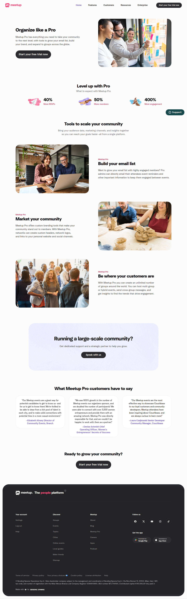

#### 4.11.3 Developer GraphQL Portal & Interactive GraphiQL Playground (`/graphql/*`)
- **Introduction to GraphQL (`/graphql/`)**: Explains Meetup's migration from REST v3 to GraphQL, rate limits (500 points per 60 seconds), and business solutions (`94_graphql_api_guide.png`).
- **Guide to GraphQL API (`/graphql/guide/`)**: Schema documentation for queries (`event`, `group`, ` groupByUrlname`, `self`) and mutations (`createEvent`, `editEvent`, `rsvp`) (`94b_graphql_guide.png`).
- **OAuth Clients Manager (`/graphql/oauth/list/`)**: Self-serve portal for registering OAuth2 redirect URIs and consumer keys (`94d_graphql_oauth_list.png`).
- **Interactive GraphiQL Playground (`/graphql/playground/`)**: Embedded browser IDE allowing authenticated developers to write queries, inspect schema docs, pass JSON `Variables` (`{"eventId": "276754274"}`) and `Headers`, and execute live GraphQL queries (`95_graphql_playground.png`, `95b_graphql_playground_executed.png`).

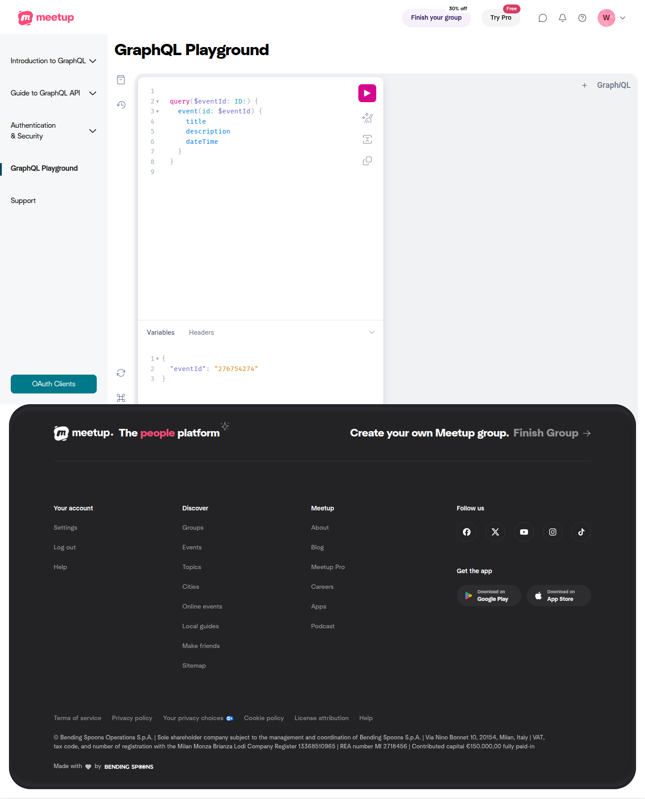

#### 4.11.4 Informational, Marketing & Error Pages
- **Mobile Apps Showcase (`/apps/`)**: Highlights iOS App Store and Google Play apps (`85_apps_mobile_download.png`).
- **Friendship & Socializing LP (`/lp/friendship-and-socializing/`)**: SEO landing page with curated friendship groups (`90_lp_friendship_socializing.png`).
- **How to Start a Group (`/how-to-group-start/`)**: Organizer marketing overview (`91_how_to_group_start.png`).
- **About Meetup (`/about/`)**: Company mission, `Careers`, `Media`, and community stories (`92_about_meetup.png`).
- **Global Sitemap (`/sitemap/`)**: Categorized index of international city/topic landing pages (`93_sitemap_directory.png`).
- **404 Error Page**: Custom illustration and copy (`"Welp, this 404 is awkward — But maybe not as awkward as when you go in for a high five and they go in for a fist bump."`) (`87_payments_received.png`).

---

## 5. Complete Catalog of Captured Screenshots (`01`–`95`)

All **141 screenshots** are stored locally in `/home/azadmin/MeetUp/screenshots/`:

| File Name | Feature Area & UI State Captured |
| :--- | :--- |
| [`01_welcome_intent_initial.png`](./screenshots/01_welcome_intent_initial.png) | Onboarding Step 1 (`/welcome/intent`): Initial landing state |
| [`01_welcome_intent_unselected.png`](./screenshots/01_welcome_intent_unselected.png) | Onboarding Step 1: Unselected state (`Continue` button disabled) |
| [`02_welcome_intent_opt1_find_groups.png`](./screenshots/02_welcome_intent_opt1_find_groups.png) | Onboarding Step 1: Option 1 selected (*"To find groups and events"*) |
| [`03_welcome_intent_opt2_create_groups.png`](./screenshots/03_welcome_intent_opt2_create_groups.png) | Onboarding Step 1: Option 2 selected (*"To create a group and host events"*) |
| [`04_welcome_intent_opt3_both.png`](./screenshots/04_welcome_intent_opt3_both.png) | Onboarding Step 1: Option 3 selected (*"Both"*) |
| [`05_welcome_organizer_intro_1.png`](./screenshots/05_welcome_organizer_intro_1.png) | Onboarding Step 2 (`/welcome/organizer-intro-1`): *"Empower your community with Meetup"* |
| [`06_welcome_organizer_intro_2.png`](./screenshots/06_welcome_organizer_intro_2.png) | Onboarding Step 3 (`/welcome/organizer-intro-2`): *"Event management made easy"* |
| [`07_welcome_organizer_intro_3.png`](./screenshots/07_welcome_organizer_intro_3.png) | Onboarding Step 4 (`/welcome/organizer-intro-3`): *"Turn your passion into profit"* |
| [`08_welcome_goal.png`](./screenshots/08_welcome_goal.png) | Onboarding Step 5 (`/welcome/goal`): *"What is your main goal on Meetup?"* default |
| [`08b_welcome_goal_chips_selected.png`](./screenshots/08b_welcome_goal_chips_selected.png) | Onboarding Step 5: Multi-select goal chips active |
| [`08c_welcome_goal_custom_input.png`](./screenshots/08c_welcome_goal_custom_input.png) | Onboarding Step 5: `+ Something else` custom goal input modal/field |
| [`09_welcome_people.png`](./screenshots/09_welcome_people.png) | Onboarding Step 6 (`/welcome/people`): *"Who are you hoping to meet?"* default |
| [`09b_welcome_people_chips_selected.png`](./screenshots/09b_welcome_people_chips_selected.png) | Onboarding Step 6: Multi-select persona chips active |
| [`10_welcome_hangout.png`](./screenshots/10_welcome_hangout.png) | Onboarding Step 7 (`/welcome/hangout`): *"How do you like to hang out?"* default |
| [`10b_welcome_hangout_chips_selected.png`](./screenshots/10b_welcome_hangout_chips_selected.png) | Onboarding Step 7: Multi-select activity chips active |
| [`11_welcome_interests.png`](./screenshots/11_welcome_interests.png) | Onboarding Step 8 (`/welcome/interests`): *"Pick at least 3 interests"* initial grid |
| [`11b_welcome_interests_selected.png`](./screenshots/11b_welcome_interests_selected.png) | Onboarding Step 8: Topics selected with dynamic `getRecommendedNewTopics` expansion |
| [`11c_welcome_interests_search.png`](./screenshots/11c_welcome_interests_search.png) | Onboarding Step 8: Live topic search (`findTopics(query: "AI")`) |
| [`12_welcome_age.png`](./screenshots/12_welcome_age.png) | Onboarding Step 9 (`/welcome/age`): Birthday input default state |
| [`12b_welcome_age_invalid.png`](./screenshots/12b_welcome_age_invalid.png) | Onboarding Step 9: Invalid date validation error state (`99/99/2025`) |
| [`12c_welcome_age_valid.png`](./screenshots/12c_welcome_age_valid.png) | Onboarding Step 9: Valid date entered (`05/15/1993`) |
| [`13_welcome_gender.png`](./screenshots/13_welcome_gender.png) | Onboarding Step 10 (`/welcome/gender`): Gender options default |
| [`13b_welcome_gender_selected.png`](./screenshots/13b_welcome_gender_selected.png) | Onboarding Step 10: Gender option selected |
| [`14_welcome_sms_number.png`](./screenshots/14_welcome_sms_number.png) | Onboarding Step 11 (`/welcome/sms-number`): SMS phone verification screen |
| [`14b_welcome_sms_country_dropdown.png`](./screenshots/14b_welcome_sms_country_dropdown.png) | Onboarding Step 11: Country dial-code dropdown menu expanded |
| [`15_welcome_whatsapp_number.png`](./screenshots/15_welcome_whatsapp_number.png) | Onboarding Step 12 (`/welcome/whatsapp-number`): WhatsApp verification screen |
| [`16_welcome_intro_paywall.png`](./screenshots/16_welcome_intro_paywall.png) | Onboarding Step 13 (`/welcome/intro-paywall`): Meetup+ 7-day trial upsell screen |
| [`16b_welcome_intro_paywall_toggled.png`](./screenshots/16b_welcome_intro_paywall_toggled.png) | Onboarding Step 13: Billing plan & free-trial switch toggled |
| [`17_welcome_groups.png`](./screenshots/17_welcome_groups.png) | Onboarding Step 14 (`/welcome/groups`): Suggested local groups grid |
| [`17b_welcome_groups_joined.png`](./screenshots/17b_welcome_groups_joined.png) | Onboarding Step 14: Local groups joined via one-click `+ Join` |
| [`18_post_onboarding_landing.png`](./screenshots/18_post_onboarding_landing.png) | Post-onboarding completion landing on `/home/` |
| [`20_home_dashboard_viewport.png`](./screenshots/20_home_dashboard_viewport.png) | Home Dashboard (`/home/`): Viewport view with hero, date strip, and curated events |
| [`20b_home_with_upcoming_event.png`](./screenshots/20b_home_with_upcoming_event.png) | Home Dashboard (`/home/`): Populated with *"Your next event"* RSVP card (`In 2 days`) |
| [`21_home_dashboard_full.png`](./screenshots/21_home_dashboard_full.png) | Home Dashboard (`/home/`): Full-page view including footer |
| [`22_header_search_focused_dropdown.png`](./screenshots/22_header_search_focused_dropdown.png) | Global Header: Keyword search input focused (Recent & Popular searches popover) |
| [`23_header_search_typeahead_python.png`](./screenshots/23_header_search_typeahead_python.png) | Global Header: Keyword search live typeahead suggestions for `"Python"` |
| [`26_header_profile_dropdown_menu.png`](./screenshots/26_header_profile_dropdown_menu.png) | Global Header: Profile avatar dropdown menu expanded |
| [`26b_header_logo_hover_homepage.png`](./screenshots/26b_header_logo_hover_homepage.png) | Global Header: Meetup logo hover morph into `Homepage` pill button |
| [`27_home_event_share_modal.png`](./screenshots/27_home_event_share_modal.png) | Home Event Card: `Share this event` modal with social links & 3 downloadable flyers |
| [`28_home_event_saved_state.png`](./screenshots/28_home_event_saved_state.png) | Home Event Card: Event bookmarked/saved (`Saved 1` counter updated) |
| [`29_try_meetup_plus_modal_or_page.png`](./screenshots/29_try_meetup_plus_modal_or_page.png) | Header CTA: `Try Meetup+` promotional modal |
| [`30_your_events_attending.png`](./screenshots/30_your_events_attending.png) | Your Events (`/your-events/`): `Going` tab empty state with mini-calendar sidebar |
| [`30b_your_events_add_to_calendar.png`](./screenshots/30b_your_events_add_to_calendar.png) | Your Events: `Add to calendar` modal (Google, iCal, Outlook) |
| [`30c_your_events_populated_going.png`](./screenshots/30c_your_events_populated_going.png) | Your Events: `Going` tab populated with upcoming RSVP |
| [`31_your_events_saved.png`](./screenshots/31_your_events_saved.png) | Your Events: `Saved` tab showing bookmarked events |
| [`32_your_events_past.png`](./screenshots/32_your_events_past.png) | Your Events: `Past` tab |
| [`34_find_events_default.png`](./screenshots/34_find_events_default.png) | Find Page (`/find/`): `Events` tab viewport with filter pills & category bar |
| [`35_find_events_full.png`](./screenshots/35_find_events_full.png) | Find Page (`/find/`): `Events` tab full-page listing |
| [`36_find_filter_day_dropdown.png`](./screenshots/36_find_filter_day_dropdown.png) | Find Filter: `Day` (`RevampedFilterButtonTime`) dropdown menu |
| [`36b_find_filter_day_custom_calendar.png`](./screenshots/36b_find_filter_day_custom_calendar.png) | Find Filter: `Day` -> `Custom` date range calendar picker |
| [`37_find_filter_size_dropdown.png`](./screenshots/37_find_filter_size_dropdown.png) | Find Filter: `Size` (`RevampedFilterButtonAttendeeCount`) multi-select popover |
| [`38_find_filter_venue_dropdown.png`](./screenshots/38_find_filter_venue_dropdown.png) | Find Filter: `Venue` (`RevampedFilterButtonVenue`: All / In person / Online) |
| [`39_find_filter_distance_dropdown.png`](./screenshots/39_find_filter_distance_dropdown.png) | Find Filter: `Distance` (`RevampedFilterButtonDistance`: 2–100 miles) |
| [`42_find_groups_tab.png`](./screenshots/42_find_groups_tab.png) | Find Page (`/find/?source=GROUPS`): `Groups` discovery tab viewport |
| [`42b_find_groups_full.png`](./screenshots/42b_find_groups_full.png) | Find Page (`/find/?source=GROUPS`): `Groups` discovery tab full page |
| [`43_find_online_events.png`](./screenshots/43_find_online_events.png) | Online Events Directory (`/find/online-events/`) |
| [`44_topics_directory.png`](./screenshots/44_topics_directory.png) | Global Topics Directory (`/topics/`) |
| [`45_topic_landing_ai.png`](./screenshots/45_topic_landing_ai.png) | Topic Landing Page (`/topics/artificial-intelligence/`) |
| [`46_cities_directory.png`](./screenshots/46_cities_directory.png) | Global Cities Directory (`/cities/`) |
| [`46b_city_landing_san_francisco.png`](./screenshots/46b_city_landing_san_francisco.png) | City Landing Page (`/find/us--ca--san-francisco/`) |
| [`47_event_detail_inperson_viewport.png`](./screenshots/47_event_detail_inperson_viewport.png) | In-Person Event Detail (`/singles-mingle-getting-people-together/events/316287001/`) |
| [`47b_event_detail_inperson_full.png`](./screenshots/47b_event_detail_inperson_full.png) | In-Person Event Detail: Full page with Leaflet map, attendees, and related events |
| [`47c_event_detail_read_more_expanded.png`](./screenshots/47c_event_detail_read_more_expanded.png) | In-Person Event Detail: `Read more` full description expanded |
| [`47d_event_share_flyer_modal.png`](./screenshots/47d_event_share_flyer_modal.png) | Event Detail: `Share a flyer` promotional graphic generator modal |
| [`47e_event_report_modal.png`](./screenshots/47e_event_report_modal.png) | Event Detail: `Report event` trust & safety modal |
| [`48_event_detail_online_full.png`](./screenshots/48_event_detail_online_full.png) | Online Pro Event Detail (`/stackle-your-career-lab/events/316515278/`) |
| [`49_event_rsvp_confirmation_modal.png`](./screenshots/49_event_rsvp_confirmation_modal.png) | Online Pro Event RSVP: *"Share your email with Stackle - Your Career Lab"* consent dialog |
| [`49d_inperson_event_rsvp_confirmation.png`](./screenshots/49d_inperson_event_rsvp_confirmation.png) | In-Person Event RSVP: *"Finish your RSVP — Are you bringing anyone?"* (`0`/`+1`/`+2` guests) |
| [`49f_event_rsvp_submitted_confirmation.png`](./screenshots/49f_event_rsvp_submitted_confirmation.png) | Post-RSVP Confirmation Modal (`You're going!`) with calendar links & recommendations |
| [`49g_event_detail_you_are_going_bar.png`](./screenshots/49g_event_detail_you_are_going_bar.png) | Event Detail: Post-RSVP sticky bar (`You are going!`) |
| [`50_event_attendees_clean.png`](./screenshots/50_event_attendees_clean.png) | Event Attendees Directory (`/events/316287001/attendees/`): `Going` tab |
| [`50b_event_attendees_sort_dropdown.png`](./screenshots/50b_event_attendees_sort_dropdown.png) | Event Attendees Directory: Sort dropdown (`Host first`, `Relevance`, `Name`, `RSVP date`) |
| [`50c_event_attendees_canceled_tab.png`](./screenshots/50c_event_attendees_canceled_tab.png) | Event Attendees Directory: `Canceled` tab |
| [`51_your_groups_page.png`](./screenshots/51_your_groups_page.png) | Your Groups Hub (`/groups/`): Joined groups & local suggestions |
| [`52_group_detail_about_viewport.png`](./screenshots/52_group_detail_about_viewport.png) | Group Detail (`/singles-mingle-getting-people-together/`): `About` tab viewport |
| [`52b_group_detail_about_full.png`](./screenshots/52b_group_detail_about_full.png) | Group Detail: `About` tab full page |
| [`53_group_events_upcoming.png`](./screenshots/53_group_events_upcoming.png) | Group Detail: `Events` -> `Upcoming` list |
| [`53b_group_events_past.png`](./screenshots/53b_group_events_past.png) | Group Detail: `Events` -> `Past` (`1,197` historical events) |
| [`53c_group_events_calendar.png`](./screenshots/53c_group_events_calendar.png) | Group Detail: `Events` -> `Calendar` monthly view (`October 2026`) |
| [`54_group_members_all.png`](./screenshots/54_group_members_all.png) | Group Detail: `Members` -> `All members (14,315)` directory |
| [`54b_group_members_leadership.png`](./screenshots/54b_group_members_leadership.png) | Group Detail: `Members` -> `Leadership team` |
| [`55_group_photos.png`](./screenshots/55_group_photos.png) | Group Detail: `Photos` -> Photo albums grid |
| [`55b_group_add_photos_modal.png`](./screenshots/55b_group_add_photos_modal.png) | Group Detail: `Photos` -> `Add photos` drag-and-drop uploader modal |
| [`55c_group_photo_album_detail.png`](./screenshots/55c_group_photo_album_detail.png) | Group Detail: `Photos` -> Individual photo album detail |
| [`56_group_discussions.png`](./screenshots/56_group_discussions.png) | Group Detail: `Discussions` board & post composer |
| [`57_group_manage_membership_menu.png`](./screenshots/57_group_manage_membership_menu.png) | Group Detail: `Manage membership` dropdown (`Membership details`, `Group notifications`, `Leave`, `Report`) |
| [`58_group_feedback_reviews.png`](./screenshots/58_group_feedback_reviews.png) | Group Detail: `Feedback overview` (`/feedback-overview/`) ratings & reviews |
| [`60_start_step1_location.png`](./screenshots/60_start_step1_location.png) | Start a Group Wizard (`/start/`): Step 1 — Location selection |
| [`61_start_step2_topics.png`](./screenshots/61_start_step2_topics.png) | Start a Group Wizard: Step 2 — Topic selection default |
| [`61b_start_step2_topics_selected.png`](./screenshots/61b_start_step2_topics_selected.png) | Start a Group Wizard: Step 2 — 3+ topics selected |
| [`62_start_step3_name.png`](./screenshots/62_start_step3_name.png) | Start a Group Wizard: Step 3 — Group name empty |
| [`62b_start_step3_name_filled.png`](./screenshots/62b_start_step3_name_filled.png) | Start a Group Wizard: Step 3 — Group name filled (`"San Francisco AI & Cloud Builders Meetup"`) |
| [`63_start_step4_description.png`](./screenshots/63_start_step4_description.png) | Start a Group Wizard: Step 4 — Group description with `Generate Description with AI` |
| [`63b_start_step4_description_filled.png`](./screenshots/63b_start_step4_description_filled.png) | Start a Group Wizard: Step 4 — Group description filled |
| [`64_start_step5_guidelines.png`](./screenshots/64_start_step5_guidelines.png) | Start a Group Wizard: Step 5 — Starter vs Standard Organizer Plan comparison matrix |
| [`65_start_step6_organizer_subscription.png`](./screenshots/65_start_step6_organizer_subscription.png) | Start a Group Wizard: Step 6 — Organizer Subscription Checkout (`/subscription/checkout/core/organizer/`) |
| [`66_member_group_profile_details.png`](./screenshots/66_member_group_profile_details.png) | Member Group Profile (`/members/484670701/group/37485736/`): Group bio & attendance history |
| [`66c_member_group_profile_edit_bio_modal.png`](./screenshots/66c_member_group_profile_edit_bio_modal.png) | Member Group Profile: Edit Group Bio / Introduction state |
| [`67_self_member_profile_page.png`](./screenshots/67_self_member_profile_page.png) | Self Member Profile (`/members/484670701/`) |
| [`69_connections_friends_page.png`](./screenshots/69_connections_friends_page.png) | Connections / Friends Page (`/friends/`) |
| [`70_messages_inbox_page.png`](./screenshots/70_messages_inbox_page.png) | Messages Inbox (`/messages/`) |
| [`71_notifications_page.png`](./screenshots/71_notifications_page.png) | Notifications Page (`/notifications/`) |
| [`72_account_edit_profile.png`](./screenshots/72_account_edit_profile.png) | Account Settings (`/account/`): Edit Profile |
| [`73_account_personal_info.png`](./screenshots/73_account_personal_info.png) | Account Settings (`/account/personal/`): Personal Info & Life Stages |
| [`74_account_management.png`](./screenshots/74_account_management.png) | Account Settings (`/account/management/`): Password, Deactivation & GDPR Requests |
| [`75_account_email_updates_comm.png`](./screenshots/75_account_email_updates_comm.png) | Account Settings (`/account/comm/`): Global Email Updates |
| [`75b_account_comm_group_specific.png`](./screenshots/75b_account_comm_group_specific.png) | Account Settings (`/account/comm/singles-mingle-getting-people-together/`): Per-Group Notification Settings |
| [`76_account_privacy.png`](./screenshots/76_account_privacy.png) | Account Settings (`/account/privacy/`): Privacy & Contact Permissions |
| [`77_account_social_services.png`](./screenshots/77_account_social_services.png) | Account Settings (`/account/services/`): Social Media Links |
| [`78_account_interests.png`](./screenshots/78_account_interests.png) | Account Settings (`/account/interests/`): Manage Followed Interests |
| [`79_account_member_plus.png`](./screenshots/79_account_member_plus.png) | Account Settings (`/account/member-plus/` -> `/subscription/checkout/member-plus/`): Meetup+ Checkout |
| [`80_account_organizer_subscription.png`](./screenshots/80_account_organizer_subscription.png) | Account Settings (`/account/subscription/`): Organizer Subscription |
| [`81_account_payment_methods.png`](./screenshots/81_account_payment_methods.png) | Account Settings (`/account/payment-methods/`): Saved Payment Methods |
| [`82_payments_made.png`](./screenshots/82_payments_made.png) | Payments Made (`/payments/payments_made/`): Event Fees Ledger |
| [`83_payments_dues_made.png`](./screenshots/83_payments_dues_made.png) | Payments Made (`/payments/dues_payments_made/`): Member Dues Ledger |
| [`84_account_oauth_apps.png`](./screenshots/84_account_oauth_apps.png) | Account Settings (`/account/oauth_apps/`): OAuth Applications |
| [`85_apps_mobile_download.png`](./screenshots/85_apps_mobile_download.png) | Mobile Apps Showcase (`/apps/`) |
| [`86_account_mobile_notifications.png`](./screenshots/86_account_mobile_notifications.png) | Account Settings (`/account/mobile/`): Push Notifications |
| [`87_payments_received.png`](./screenshots/87_payments_received.png) | Meetup Custom 404 Error Page (`"Welp, this 404 is awkward"`) |
| [`87b_payments_received.png`](./screenshots/87b_payments_received.png) | Payments Received (`/payments/`): Organizer Revenue Ledger |
| [`88_meetup_pro_landing.png`](./screenshots/88_meetup_pro_landing.png) | Meetup Pro Enterprise Landing Page (`/meetup-pro/`) |
| [`90_lp_friendship_socializing.png`](./screenshots/90_lp_friendship_socializing.png) | Friendship & Socializing Marketing Landing Page (`/lp/friendship-and-socializing/`) |
| [`91_how_to_group_start.png`](./screenshots/91_how_to_group_start.png) | How to Start a Group Page (`/how-to-group-start/`) |
| [`92_about_meetup.png`](./screenshots/92_about_meetup.png) | About Meetup Page (`/about/`) |
| [`93_sitemap_directory.png`](./screenshots/93_sitemap_directory.png) | Global Sitemap Directory (`/sitemap/`) |
| [`94_graphql_api_guide.png`](./screenshots/94_graphql_api_guide.png) | Developer API Portal: Introduction to GraphQL (`/graphql/`) |
| [`94b_graphql_guide.png`](./screenshots/94b_graphql_guide.png) | Developer API Portal: Guide to GraphQL API (`/graphql/guide/`) |
| [`94d_graphql_oauth_list.png`](./screenshots/94d_graphql_oauth_list.png) | Developer API Portal: Your OAuth Clients (`/graphql/oauth/list/`) |
| [`95_graphql_playground.png`](./screenshots/95_graphql_playground.png) | Developer API Portal: Interactive GraphiQL Playground (`/graphql/playground/`) |
| [`95b_graphql_playground_executed.png`](./screenshots/95b_graphql_playground_executed.png) | Developer API Portal: GraphiQL Query Execution State |
